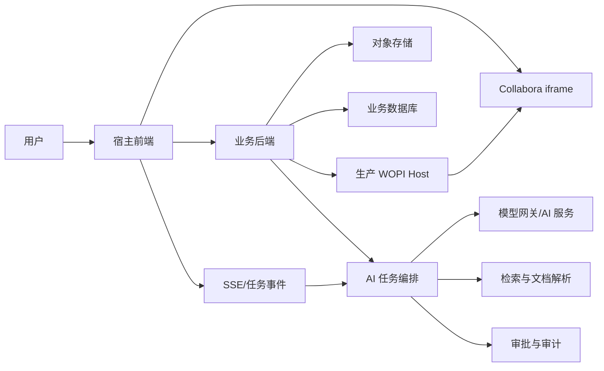

# 基于 Collabora 的 AI 文档助手方案与技术验证报告

> 项目范围：`Collabora-lingqing-demo`  
> 文档定位：立项方案、技术验证结论、前后端与 AI 任务拆分  
> 当前阶段：前端与 Collabora 基础能力原型；正式后端服务和 AI 能力待接入

## 1. 结论

本项目可以作为 AI 文档助手的宿主应用。Collabora Online 负责 DOCX 的在线展示与编辑；宿主前端负责 AI 对话、工具审批和编辑指令下发；后端负责文档、权限、版本、任务和 WOPI 服务；AI 服务负责理解、生成和工具规划。

推荐首期采用“AI 副驾驶”模式：

1. 用户在 Collabora 中编辑或选择内容。
2. 用户在宿主 AI 面板提出要求。
3. AI 返回建议和待执行工具。
4. 用户批准后，宿主前端向当前 Collabora iframe 下发受控编辑指令。
5. Collabora 保存文档，后端记录新版本和审计信息。

首期不建议把 AI 实现为一个独立的在线协作者。该方式需要第二个编辑会话、协作身份、光标定位、冲突处理和完整锁机制，成本和风险明显更高。

当前原型已证明基础链路可行，但尚不具备生产条件。真实 AI、选区读取、WOPI 锁、持久化、鉴权、版本恢复、幂等和审计仍需建设。

## 2. 建设目标与范围

### 2.1 首期目标

- DOCX 上传、在线打开、编辑、保存、下载和导出。
- 宿主页面内提供 AI 对话面板。
- AI 支持总结、续写、改写、翻译、插入文本和生成目录草案。
- AI 内容先预览，用户批准后再修改文档。
- AI 返回过程可流式展示，写入文档时不丢字、不重复。
- 每次 AI 修改可追踪、可重试、可恢复。
- 文档权限、WOPI 锁、版本和审计满足生产要求。

### 2.2 暂不纳入首期

- AI 以独立用户身份加入 Collabora 实时协作。
- AI 直接调用任意 UNO 命令。
- 无审批的高风险整篇覆盖。
- 复杂排版、图表、公式和任意版式的自动重构。
- 把普通文本目录宣称为 Word 原生可更新目录。

## 3. 当前项目技术验证结论

### 3.1 已验证

| 能力 | 当前实现 | 结论 |
|---|---|---|
| 文档接入 | 上传 DOCX，生成 WOPI URL 和访问令牌 | 基础链路可用 |
| 在线编辑 | Collabora 通过 iframe 嵌入宿主 | 可用 |
| WOPI 基础接口 | CheckFileInfo、GetFile、PutFile | 已跑通基础读写 |
| 宿主通信 | 校验 `event.source` 和 `event.origin` 后使用 postMessage | 基础通信可用 |
| 编辑器就绪 | 处理 `Host_PostmessageReady` | 可在就绪后发送指令 |
| 文本写入 | `Send_UNO_Command` 调用 `.uno:InsertText` | 可写入光标或选区位置 |
| 富文本写入 | `Action_Paste` 写入受控 HTML/纯文本 | 可用于结构化内容原型 |
| 保存 | `Action_Save` 并处理保存响应 | 可触发保存并观察结果 |
| 导出 | `Action_Export` | 可导出支持的格式 |
| AI 流式演示 | 宿主通过模拟 SSE 接收内容 | 流式 UI 可用 |
| 防止流式丢字 | 宿主先完整接收，再一次性写入 Collabora | 当前方案可避免逐字写入导致的丢失 |

### 3.2 仅完成演示，不能视为正式能力

| 能力 | 当前状态 | 正式实现要求 |
|---|---|---|
| AI 生成 | 使用模拟 SSE 和固定内容 | 接入真实模型网关、提示词、上下文和安全策略 |
| 优化选中文字 | 写入固定示例内容 | 读取或可靠提交真实选区，校验选区未变化后替换 |
| 生成目录 | 写入静态多级文本 | 解析真实标题层级；明确普通目录或原生 Word TOC 路线 |
| 文档存储 | Node 内存 Map | 对象存储、数据库、版本和备份 |
| 访问令牌 | 随机令牌，无完整生命周期 | 用户-文档-会话绑定、短时有效、可撤销 |
| 并发控制 | `SupportsLocks: false` | 实现 WOPI Lock、RefreshLock、Unlock、UnlockAndRelock |
| 用户身份 | 固定用户信息 | 对接组织、租户、权限和审计主体 |

### 3.3 尚未验证的关键问题

1. 能否稳定读取 Collabora 当前真实选区及其上下文。
2. AI 生成期间用户改变选区后，如何检测并阻止误替换。
3. 原生 Word 目录的生成、页码、超链接和更新兼容性。
4. 双用户并发编辑、AI 写入与人工输入同时发生时的行为。
5. 大文档、复杂 DOCX、网络中断、重复请求和 Collabora 升级兼容性。
6. 保存成功、后端持久化成功和版本生成成功之间的一致性。

## 4. 目标架构



职责边界：

| 模块 | 负责 | 不负责 |
|---|---|---|
| Collabora | 文档渲染、编辑、协作、保存、导出 | AI 推理、业务审批、任务审计 |
| 宿主前端 | AI 面板、上下文采集、结果预览、审批、受控指令执行 | 长期存储、模型密钥、最终权限判定 |
| 业务后端 | 鉴权、文档、版本、任务、幂等、审计 | 在浏览器中直接操作 iframe |
| WOPI Host | Collabora 文件读取、写入、锁与权限声明 | AI 内容生成 |
| AI 服务 | 理解意图、生成内容、规划白名单工具 | 直接持有 Collabora 控制权 |

## 5. 两条文档修改链路

### 5.1 当前打开文档的交互式修改

适用于插入、改写、翻译、摘要和目录草案。

```text
用户发起请求
  → 前端提交文档 ID、当前版本、选区/光标上下文
  → 后端创建 AI Job
  → AI 流式返回内容和工具提议
  → 前端展示预览
  → 用户批准
  → 前端向当前 Collabora iframe 执行白名单指令
  → 触发保存
  → 后端确认文件版本
  → 记录工具结果和审计
```

该链路复用当前用户的编辑会话。AI 是“建议者”，不是第二个 Collabora 用户。

### 5.2 后端批量修改

适用于无人值守处理、模板生成和整篇转换。

```text
冻结或读取版本 N
  → 提取文档结构
  → AI 生成结构化修改结果
  → 转换生成候选版本 N+1
  → 差异预览与审批
  → 发布 N+1 或回滚
```

后端不得直接覆盖用户正在编辑的活动版本。批处理应生成候选版本，通过合并、重新打开或明确替换完成发布。

## 6. 后端建设方案

### 6.1 业务接口建议

| 接口 | 用途 |
|---|---|
| `POST /api/documents` | 创建或上传文档 |
| `GET /api/documents/:id/session` | 获取 Collabora 启动参数和短时令牌 |
| `POST /api/documents/:id/checkpoints` | 创建 AI 操作前检查点 |
| `GET /api/documents/:id/versions` | 查询版本列表 |
| `POST /api/documents/:id/ai/jobs` | 创建 AI 任务 |
| `GET /api/ai/jobs/:jobId` | 查询任务状态和结果 |
| `GET /api/ai/jobs/:jobId/events` | SSE 推送生成进度和状态 |
| `POST /api/ai/tool-calls/:id/decision` | 批准或拒绝工具调用 |
| `POST /api/ai/tool-calls/:id/result` | 前端回传执行和保存结果 |

### 6.2 AI Job 状态机

```text
created
  → generating
  → waiting_for_approval
  → approved
  → applying
  → saving
  → completed
```

异常终态：`rejected`、`cancelled`、`expired`、`failed`。

每个任务至少保存：

- `jobId`、`documentId`、`userId`、`tenantId`。
- 请求时文档版本、选区快照或定位标识。
- 模型、提示词版本、输入摘要和生成结果。
- 工具名称、参数、审批人、审批时间和执行结果。
- 保存响应、新文档版本、失败原因和重试次数。

### 6.3 生产 WOPI Host

必须建设：

- CheckFileInfo、GetFile、PutFile。
- Lock、RefreshLock、Unlock、UnlockAndRelock。
- 对象存储与元数据持久化。
- 原子写入、版本号、校验值和冲突响应。
- 用户/租户/文档权限校验。
- 短时令牌、撤销、日志脱敏和访问审计。
- 保存失败重试、断点恢复和备份策略。

## 7. AI 服务建设方案

### 7.1 AI 服务组成

- 模型网关：统一模型调用、限流、超时、降级和用量统计。
- 上下文构建：组合用户请求、选区、标题、段落和文档摘要。
- 文档解析：提取正文、标题层级、表格和必要的结构信息。
- 工具规划：只输出已注册的业务工具和结构化参数。
- 结果校验：检查长度、格式、敏感信息、越权意图和空结果。
- 任务编排：处理流式输出、审批、执行回执、重试和取消。
- 可选 RAG：检索企业知识库并返回可追溯来源。

### 7.2 首期工具白名单

| 工具 | 输入 | 执行方 | 是否审批 |
|---|---|---|---|
| `insert_text` | 文本、目标位置 | 前端 | 是 |
| `replace_current_selection` | 原选区摘要、新文本、选区校验值 | 前端 | 是 |
| `generate_outline` | 标题层级、目录内容 | 前端/后端 | 是 |
| `summarize_document` | 文档版本、范围 | AI 服务 | 否，仅生成结果 |
| `save_document` | 文档 ID、预期版本 | 前端/后端 | 可自动执行 |
| `export_document` | 格式、文件名 | 前端/后端 | 可按策略执行 |

模型不能直接生成并执行任意 UNO 命令。AI 只调用业务工具，工具适配层再映射到 Collabora 能力。

### 7.3 流式输出策略

流式内容只用于 AI 面板展示。不要把每个字符或 token 连续发送给 Collabora，原因包括输入焦点变化、消息乱序、渲染节流、选区变化和命令执行时机不稳定。

推荐方式：

1. AI 内容在宿主面板流式展示。
2. 后端发送完成事件和最终文本。
3. 前端校验任务、文档版本和目标位置。
4. 用户批准后一次性写入，或按完整段落分块并串行确认。
5. 保存成功后将新版本回传后端。

## 8. 选区、目录与定位方案

### 8.1 选区替换

这是首期最重要的技术验证。

优先方案：通过 Collabora 官方支持的 postMessage/集成能力获取选区或选区上下文。若目标版本无法可靠提供，则采用降级方案：用户点击“发送选中文字给 AI”时，由宿主获取可用上下文；仍不可用时，让用户在 AI 面板粘贴待改内容，AI 返回结果后由用户重新选择并确认替换。

替换前必须校验：

- iframe 和文档 ID 未变化。
- 当前文档版本与任务创建时一致或允许合并。
- 当前选区仍与原选区摘要/校验值匹配。
- 用户焦点没有移动到其他编辑位置。

校验失败时只展示结果，不自动写入。

### 8.2 目录

需要区分两类能力：

- 目录草案：解析标题后插入多级普通文本。实现快，但无自动页码和更新能力。
- Word 原生目录：依赖规范的标题样式、目录字段、更新与兼容性验证。

首期建议交付目录草案，同时单独验证原生 Word TOC。标题层级应来自实际文档结构，不能使用固定示例。

### 8.3 稳定定位

不要仅依赖“AI 请求发起时的当前选区”。AI 生成可能持续数秒，用户会继续编辑。可选策略按优先级为：

1. 选区快照和校验值。
2. 内容控件、命名区域或业务锚点。
3. AI 生成期间锁定该次操作目标，并要求用户重新确认。
4. 失败时降级为复制结果或在当前光标插入。

## 9. Human in the Loop

宿主前端可以完整承载工具调用、批准、拒绝、修改参数和取消任务。

建议交互：

1. AI 面板展示生成内容和影响范围。
2. 高亮工具类型：插入、替换、整篇修改、保存或导出。
3. 展示目标文档、目标位置和预计影响字数。
4. 用户选择批准、拒绝或编辑后批准。
5. 执行期间禁止重复提交。
6. 保存完成后展示版本号和撤销/恢复入口。

默认需要审批的操作：替换选区、删除、整篇覆盖、批量格式调整和版本发布。纯问答、总结预览可免审批。

## 10. 风险与处理

| 风险 | 影响 | 处理方案 | 验证优先级 |
|---|---|---|---|
| 无法稳定读取选区 | 改写无法闭环 | 官方能力验证；准备人工提交文本降级方案 | P0 |
| AI 生成时选区变化 | 内容写错位置 | 快照、校验、重新确认、失败不写入 | P0 |
| 逐 token 写入丢字 | 文档内容不完整 | 面板流式、完成后原子写入 | 已处理 |
| 重复事件或重试 | 重复插入 | `jobId + toolCallId` 幂等键 | P0 |
| 保存响应不等于持久化成功 | 页面显示与文件不一致 | 等待保存响应并核对后端版本/校验值 | P0 |
| 并发覆盖 | 用户修改丢失 | WOPI 锁、预期版本、冲突提示和候选版本 | P0 |
| 任意 UNO 命令 | 越权或破坏文档 | 工具白名单、参数校验、审批和审计 | P0 |
| HTML 注入 | 内容或安全问题 | HTML 白名单、转义、禁止脚本和外链资源 | P1 |
| Collabora 内部 DOM/CSS 变化 | 升级后定制失效 | 优先官方配置和 postMessage；减少 DOM/CSS 侵入 | P1 |
| 大文档上下文超限 | 延迟、成本和结果下降 | 分段解析、摘要索引、按需检索 | P1 |
| 外部模型数据泄露 | 合规风险 | 数据分级、脱敏、企业模型网关、禁止训练配置 | P0 |
| DOCX 格式兼容 | 排版或字段损坏 | 建立复杂文档回归样本和版本矩阵 | P1 |

## 11. 实施任务拆分

### 11.1 前端

- 完成 AI 对话、SSE、停止生成、重试和错误状态。
- 定义工具卡片、参数预览、批准、拒绝和执行结果 UI。
- 封装 Collabora 通信层：来源校验、就绪状态、请求关联和超时。
- 建立业务工具到 postMessage/UNO 的受控映射。
- 实现一次性或完整段落写入，禁止逐 token 写文档。
- 验证选区读取、选区一致性和安全降级路径。
- 保存后等待响应，并向后端回传版本结果。
- 支持任务取消、页面切换保护和失败恢复提示。

### 11.2 后端

- 实现用户、租户、文档和权限模型。
- 将内存文件迁移到对象存储，元数据迁移到数据库。
- 建设生产 WOPI Host、锁、版本、校验值和冲突处理。
- 签发短时 WOPI 令牌，限制文档、用户和操作范围。
- 实现 AI Job、SSE 事件、审批、幂等、重试和取消。
- 实现操作前检查点、版本历史、恢复和审计日志。
- 对接模型网关、内容安全、配额、成本和监控。

### 11.3 AI

- 定义总结、续写、改写、翻译和目录的提示词与输出结构。
- 设计工具 schema，只允许调用注册工具。
- 构建文档/选区上下文和长文档分段策略。
- 实现真实流式生成、取消、超时和降级模型。
- 对生成结果做格式、长度、敏感信息和空结果校验。
- 建立评测集：事实保持、格式保持、改写质量和误操作率。
- 如接企业知识库，增加检索、引用和权限继承。

### 11.4 测试与运维

- 覆盖 Chrome/Edge、不同 Collabora 版本和常见 DOCX 类型。
- 测试断网、刷新、重复审批、重复保存和服务重启。
- 测试两人协作、保存冲突、锁超时和恢复。
- 建立性能指标：首 token、生成耗时、写入耗时和保存耗时。
- 建立安全指标：越权、令牌泄露、提示词注入和敏感信息外发。

## 12. 分阶段计划

以下为 1 名前端、1 名后端、1 名 AI 工程师并行，测试与运维共享的估算。

### 阶段 0：关键 POC，1—2 周

- 接入真实模型 SSE。
- 验证真实选区读取和改写闭环。
- 完成最小审批流程。
- 验证标题提取和目录路线。
- 验证 WOPI 锁、幂等和保存确认方案。

退出条件：选区能力有明确可行方案或可接受的降级方案；AI 修改不会丢字、重复或写错位置。

### 阶段 1：业务 MVP，2—4 周

- AI 对话与任务状态机。
- 插入、改写、翻译、总结、目录草案。
- 工具白名单与批准/拒绝。
- 检查点、操作日志、保存结果回传。

退出条件：真实模型完成端到端业务闭环，失败不会破坏原文档。

### 阶段 2：生产文件与安全，3—5 周

- 对象存储、数据库、权限、短时令牌。
- 完整 WOPI 锁、版本、恢复和备份。
- 并发、性能、安全与兼容性测试。

退出条件：服务重启不丢文件，并发修改可检测，操作可审计和恢复。

### 阶段 3：结构化自动化，3—6 周

- 原生 TOC、复杂结构提取与转换。
- 批量生成候选版本和差异审批。
- 企业知识库、模板和质量评测。

具体周期取决于现有账号、存储、权限和模型平台的复用程度。

## 13. 验收标准

### 13.1 功能

- 真实 AI 可以流式返回，最终写入内容完整且顺序正确。
- 插入和替换必须先预览；需审批操作未经批准不能执行。
- 选区失效或版本变化时停止写入并提示重新确认。
- 保存有明确响应，后端生成可查询的新版本。
- 相同工具调用重复提交不会重复修改文档。
- 失败后原文档可继续打开，并可恢复到操作前版本。

### 13.2 生产

- 文件和任务状态持久化，服务重启后不丢失。
- WOPI 令牌短时有效，并绑定用户、租户和文档。
- WOPI 锁与并发冲突处理通过测试。
- AI 输入、输出、审批、执行和保存均有审计记录。
- 敏感文档按数据策略决定是否允许发送给外部模型。
- 常见复杂 DOCX 回归样本不出现不可接受的格式损坏。

## 14. 立项前需要确认的决策

| 决策 | 建议 |
|---|---|
| AI 是否作为独立协作者 | 首期否，采用当前用户会话内的 AI 副驾驶 |
| AI 修改是否审批 | 首期必须审批，高风险操作长期保留审批 |
| 选区读取失败是否阻塞项目 | 不阻塞，提供粘贴/重新选择的降级方案 |
| 目录交付形式 | 首期目录草案；原生 Word TOC 单独 POC |
| 后端能否覆盖活动版本 | 禁止，必须走锁、版本或候选版本 |
| 是否允许模型生成 UNO | 禁止，只允许业务工具白名单 |
| 是否接外部模型 | 根据数据分级和合规要求决定，统一走模型网关 |

## 15. 官方资料

- [Collabora Online PostMessage API](https://sdk.collaboraonline.com/docs/postmessage_api.html)
- [Collabora Online SDK Manual](https://sdk.collaboraonline.com/CO-SDK-manual.pdf)
- [Collabora Online source mirror](https://github.com/CollaboraOnline/online.mirror)
- [Collabora client/server protocol](https://github.com/CollaboraOnline/online.mirror/blob/main/wsd/protocol.txt)
- [Collabora Extract and Transform API](https://sdk.collaboraonline.com/docs/extract_transform_api.html)
- [Microsoft WOPI REST endpoints](https://learn.microsoft.com/en-us/microsoft-365/cloud-storage-partner-program/rest/endpoints)
- [WOPI CheckFileInfo](https://learn.microsoft.com/en-us/microsoft-365/cloud-storage-partner-program/rest/files/checkfileinfo)
- [WOPI GetFile](https://learn.microsoft.com/en-us/microsoft-365/cloud-storage-partner-program/rest/files/getfile)
- [WOPI PutFile](https://learn.microsoft.com/en-us/microsoft-365/cloud-storage-partner-program/rest/files/putfile)
- [WOPI concepts and locks](https://learn.microsoft.com/en-us/microsoft-365/cloud-storage-partner-program/rest/concepts)

