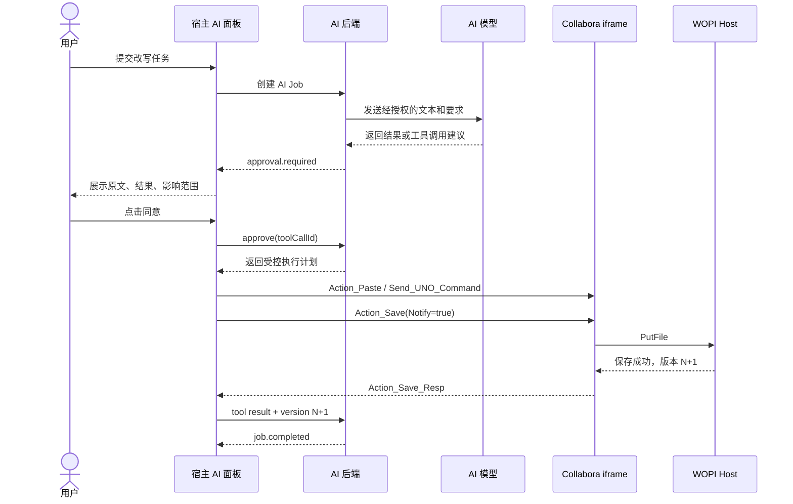
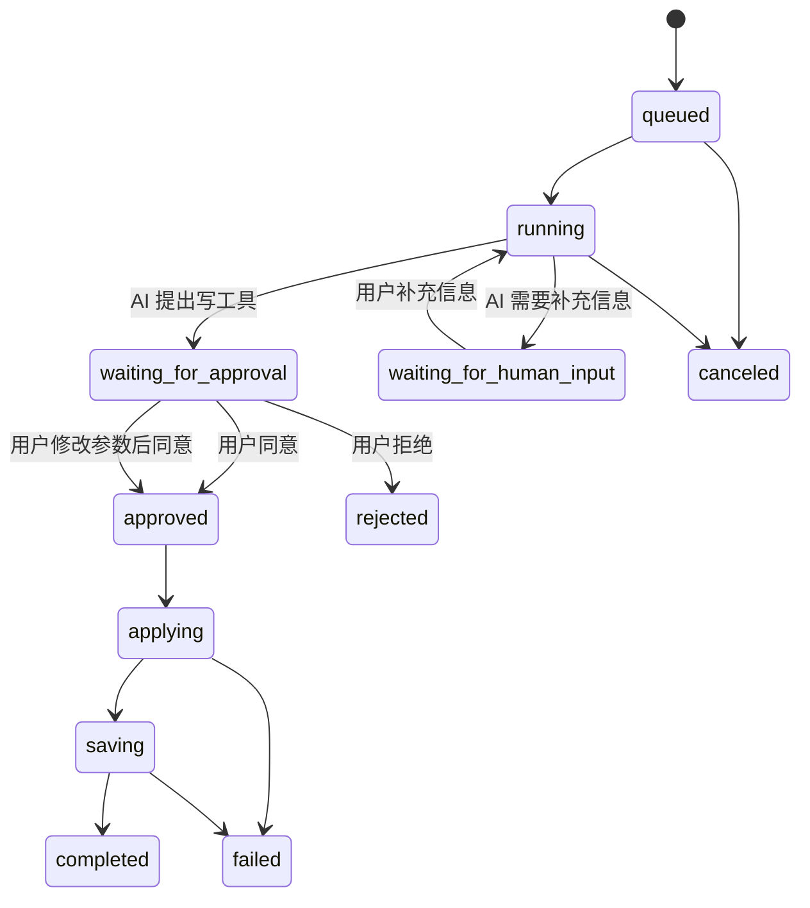
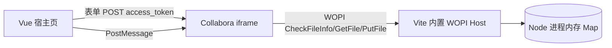
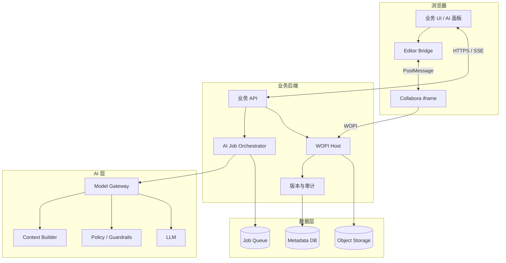
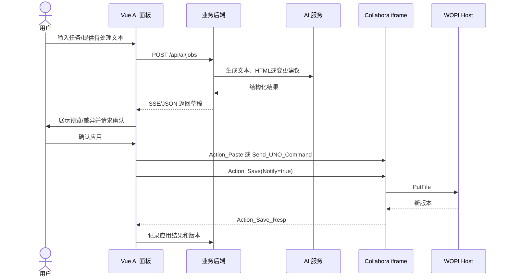
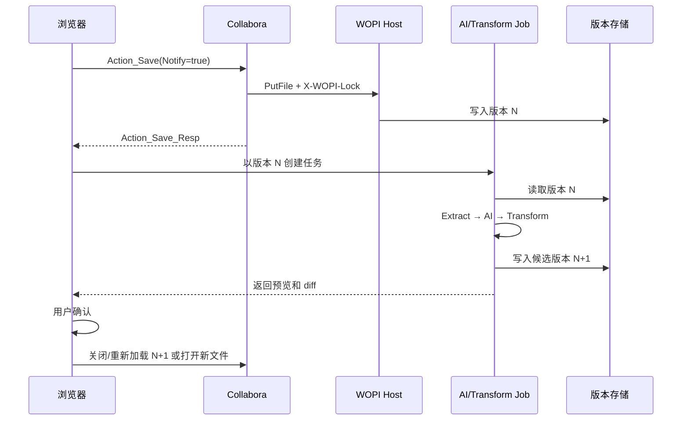
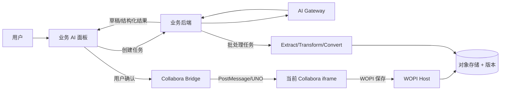

# Collabora Online + AI 文档编辑可行性与实施方案

> 项目：`Collabora-lingqing-demo`  
> 适用版本：当前项目已记录的 Collabora Online Development Edition `26.04.3.1`  
> 编制日期：2026-08-20  
> 目标：评估 AI 层或业务后端操作当前在线文档的可行性，并给出前端、后端、AI、运维与测试的可执行任务拆分。

---

## 0. 先读这一章：用最容易理解的方式讲清整套系统

如果后面的 WOPI、PostMessage、UNO、Tool Calling 等概念暂时不熟悉，先只阅读本章。本章读完后，应当能够回答下面四个问题：

1. 宿主里的 AI 面板如何与 Collabora iframe 通信？
2. AI 提出工具调用后，谁负责审批，谁真正执行？
3. Human in the Loop 如何暂停、同意、拒绝、修改参数和继续执行？
4. 当前技术阻碍中，哪些可以解决，哪些只能绕开或专项验证？

### 0.1 一句话结论

**可以实现完整的 AI 对话、流式回答、工具调用、审批、拒绝、补充信息、文档写入、保存、版本和审计。**

实现的关键不是让 AI 后端直接控制 Collabora，而是让**宿主系统成为总编排器**：

```text
AI 后端负责思考和提出操作
宿主前端负责控制当前 Collabora iframe
Collabora 负责真正编辑 Office 文档
WOPI 后端负责保存、权限、锁和版本
用户负责高风险操作的最终决定
```

有两个能力不能按“已经完全解决”来承诺：

1. 宿主外置 AI 面板通过当前已核验的公共 PostMessage API，无感读取任意未保存选区全文。
2. 后端 AI 不依赖浏览器、直接以独立用户和独立光标加入当前实时协作会话。

这两个限制不影响实现一个可用、可控、可审计的 AI Copilot。

### 0.2 把各模块想象成五个角色

| 技术模块 | 容易理解的角色 | 它真正负责什么 |
| --- | --- | --- |
| 宿主页面 | 总控制台 | 同时承载 AI 面板和 Collabora iframe，负责把各方连接起来 |
| AI 面板 | 对话窗口 | 接收用户需求、展示结果和审批卡片，不直接修改 DOCX |
| AI 后端 | 思考者和任务经理 | 调用模型、生成工具建议、保存任务状态、等待人工决定 |
| Collabora iframe | 文档编辑员 | 真正执行插入、替换、格式、保存等编辑动作 |
| WOPI Host | 文件柜和门卫 | 管理文件、用户权限、token、锁、版本、下载和恢复 |

最容易产生误解的地方是：

> AI 模型不是直接拿着 Collabora API 随意操作文档；AI 只提出一个受约束的“工具建议”，业务系统检查并获得用户同意后，才把它翻译成 Collabora 命令。

### 0.3 宿主 AI 面板和 Collabora iframe 如何通信

宿主页面里同时存在两个区域：

```text
┌──────────────────────────宿主页面──────────────────────────┐
│                                                           │
│  ┌───────────────┐                  ┌───────────────────┐  │
│  │   AI 对话面板  │                  │ Collabora iframe  │  │
│  │               │                  │                   │  │
│  │ 对话           │                  │ Word 编辑器        │  │
│  │ 工具审批卡片    │                  │ 当前光标/选区       │  │
│  │ 执行进度        │                  │ 文档内容            │  │
│  └───────┬───────┘                  └─────────▲─────────┘  │
│          │                                        │        │
│          └──────── 宿主前端编排器 ─────────────────┘        │
│                           PostMessage                       │
└───────────────────────────┬─────────────────────────────────┘
                            │ HTTPS / SSE
                            ▼
                   ┌─────────────────┐
                   │ 业务后端 / AI层 │
                   │ Job / Approval  │
                   │ Tool / Audit    │
                   └────────┬────────┘
                            │
                            ▼
                         AI 模型

Collabora iframe ───────── WOPI ─────────> WOPI Host / 文件存储
```

它们使用三条不同的通信通道：

#### 通道一：AI 面板与 AI 后端

使用业务 HTTP API 和 SSE：

```text
POST /api/documents/:id/ai/jobs        创建 AI 任务
GET  /api/ai/jobs/:jobId/events        接收流式事件
POST /api/ai/tool-calls/:id/decision   同意、拒绝或修改参数
POST /api/ai/tool-calls/:id/result     报告工具执行结果
```

这条通道负责：

- 多轮对话。
- 流式输出。
- AI 工具调用建议。
- Human in the Loop。
- 暂停、继续、取消、超时和重试。
- 任务与审批审计。

#### 通道二：宿主前端与 Collabora iframe

使用浏览器官方 `window.postMessage`：

```text
宿主前端 → Collabora：Action_Paste / Send_UNO_Command / Action_Save
Collabora → 宿主前端：App_LoadingStatus / Doc_ModifiedStatus / Action_Save_Resp
```

这条通道负责：

- 在当前光标插入内容。
- 替换当前选区。
- 触发经过验证的 UNO 命令。
- 保存当前文档。
- 查询导出格式和协作者。
- 接收加载、修改和保存状态。

#### 通道三：Collabora 与 WOPI Host

使用 WOPI HTTP：

```text
CheckFileInfo  确认文件、用户和权限
GetFile        读取 DOCX
PutFile        保存 DOCX
Lock           建立文件锁
RefreshLock    刷新文件锁
Unlock         释放文件锁
```

这条通道负责最终文件持久化。AI 面板不能只看到“命令发送成功”就认为已经保存，必须等 Collabora 通过 `PutFile` 将文件真正写回 WOPI Host。

### 0.4 一次完整的 AI 修改文档是怎样发生的

以“把这段话改写得更正式”为例：



把这个流程拆开看：

1. 用户在宿主 AI 面板里提交需求。
2. 宿主前端调用业务后端创建 AI Job。
3. 后端只把用户已授权的内容发送给模型。
4. 模型生成文本，或返回一个业务工具建议。
5. 后端验证工具名称、参数、权限和风险，不立即执行。
6. 后端把任务状态改成 `waiting_for_approval`。
7. AI 面板展示审批卡片。
8. 用户可以同意、修改后同意、拒绝或补充要求。
9. 用户同意后，后端返回一个受控的执行计划。
10. 宿主前端把执行计划映射成固定的 Collabora PostMessage。
11. Collabora 修改当前文档。
12. 宿主前端调用 `Action_Save`。
13. Collabora 调用 WOPI `PutFile` 保存完整 DOCX。
14. 宿主收到 `Action_Save_Resp`，并查询后端确认版本已经递增。
15. 前端报告工具成功，后端把 AI Job 标记为完成。

因此，即使 AI 模型返回了错误的工具建议，它也不能跳过后端校验和用户审批直接修改文档。

### 0.5 Tool Calling 到底如何落地

#### 第一步：只向模型开放业务工具

不要向模型开放任意 `.uno:*`。只定义少量容易理解的业务工具：

```json
[
  {
    "name": "insert_text",
    "description": "在当前光标处插入纯文本",
    "parameters": {
      "text": "string"
    }
  },
  {
    "name": "replace_current_selection",
    "description": "用安全 HTML 替换当前选区",
    "parameters": {
      "html": "string"
    }
  },
  {
    "name": "save_document",
    "description": "保存当前文档",
    "parameters": {}
  },
  {
    "name": "export_pdf",
    "description": "把已保存版本导出为 PDF",
    "parameters": {}
  }
]
```

#### 第二步：模型只提出建议

模型可能返回：

```json
{
  "toolCallId": "tool_123",
  "tool": "replace_current_selection",
  "arguments": {
    "html": "<p>改写后的正式文本</p>"
  }
}
```

此时不会立刻修改文档。后端必须检查：

- `tool` 是否在白名单。
- 参数是否符合 JSON Schema。
- 当前用户是否有编辑权限。
- 当前文档是否允许 AI 修改。
- HTML 是否经过安全净化。
- 是否需要人工审批。
- `toolCallId` 是否已经执行过。

#### 第三步：根据执行位置路由

| 工具 | 执行器 | 原因 |
| --- | --- | --- |
| `insert_text` | 宿主前端 | 只有浏览器持有当前 iframe |
| `replace_current_selection` | 宿主前端 | 操作当前 Collabora 光标/选区 |
| `save_document` | 宿主前端发起，Collabora/WOPI 完成 | 保存必须经过当前编辑会话 |
| `summarize_saved_document` | AI 后端 | 后端读取用户授权的已保存版本 |
| `fill_content_controls` | 后端 Transform Worker | 属于文件结构批处理 |
| `export_pdf` | 后端 Convert Worker 或当前编辑器 | 取决于产品流程 |
| 查询业务数据 | 业务后端 | 不应交给浏览器或 Collabora |

后端批准后，不返回任意 PostMessage，而是返回受控执行计划：

```json
{
  "toolCallId": "tool_123",
  "executor": "browser_editor",
  "action": "replace_current_selection",
  "arguments": {
    "html": "<p>已经净化的正式文本</p>"
  },
  "applyId": "apply_456"
}
```

前端使用固定映射执行：

```ts
switch (plan.action) {
  case 'insert_text':
    return editor.insertText(plan.arguments.text)
  case 'replace_current_selection':
    return editor.pasteHtml(plan.arguments.html)
  case 'save_document':
    return editor.save()
}
```

这样就算模型要求执行一个系统未允许的操作，也无法穿透白名单。

### 0.6 Human in the Loop 如何实现

Human in the Loop 不是一个弹窗，而是后端持久化的任务状态机：



#### 审批卡片应该显示什么

```text
AI 请求执行文档操作

操作：替换当前选区
影响：会改变当前文档内容
原内容：……
新内容：……
风险：中

[同意并执行] [修改结果后执行] [拒绝] [继续询问 AI]
```

#### 决策接口

同意：

```json
{
  "decision": "approve"
}
```

拒绝：

```json
{
  "decision": "reject",
  "reason": "内容不符合要求"
}
```

修改后同意：

```json
{
  "decision": "approve_with_changes",
  "arguments": {
    "html": "<p>用户修订后的最终内容</p>"
  }
}
```

需要补充信息：

```json
{
  "decision": "provide_input",
  "input": "语气正式，但不要改变数字和日期"
}
```

#### 为什么状态必须保存在后端

如果只保存在浏览器内存：

- 刷新页面后审批丢失。
- 用户换设备后无法继续。
- 无法阻止同一个工具重复执行。
- 无法审计谁在什么时候批准了什么。

所以 `jobId`、`toolCallId`、状态、审批人、审批参数、`applyId` 和最终文档版本都必须持久化。

### 0.7 各种常见 AI 对话情况能否实现

| AI 对话情况 | 能否实现 | 实现方式 |
| --- | --- | --- |
| 普通多轮对话 | 可以 | 会话表 + AI Job + SSE |
| 流式输出 | 可以 | SSE `message.delta` |
| AI 调用一个工具 | 可以 | Tool Schema + Tool Router |
| 一次连续调用多个工具 | 可以 | 每个工具独立 `toolCallId`，按顺序或依赖执行 |
| 工具执行前让用户同意 | 可以 | `waiting_for_approval` |
| 用户拒绝工具 | 可以 | 标记 `rejected`，结果返回模型继续对话 |
| 用户修改工具参数再同意 | 可以 | `approve_with_changes` |
| AI 请求用户补充资料 | 可以 | `waiting_for_human_input` |
| 审批超时 | 可以 | `expiresAt` 后自动取消或重新确认 |
| 用户取消生成 | 可以 | `/cancel` + 模型请求取消 |
| 页面刷新后恢复 | 可以 | 根据 jobId 查询状态，SSE 使用事件序号续连 |
| 工具失败后重试 | 可以 | 幂等键 + 可重试错误分类 |
| 两人同时审批 | 可以控制 | 审批版本号/原子状态更新，只允许第一个合法决定生效 |
| AI 修改后自动保存 | 可以 | 写入审批中明确包含保存，完成后确认 WOPI 版本 |
| AI 自动删除或覆盖文档 | 技术可做但不建议 | 必须二次确认和版本恢复能力 |

建议 SSE 事件类型：

```text
message.delta
message.completed
tool.proposed
approval.required
human_input.required
tool.started
tool.completed
tool.failed
document.saving
document.saved
turn.completed
turn.failed
```

### 0.8 文档中提到的阻碍，分别怎样解决

| 阻碍 | 是否能解决 | 推荐解决办法 | 剩余边界 |
| --- | --- | --- | --- |
| iframe 跨域，宿主不能读 DOM | 可以 | 不读 DOM，使用官方 PostMessage；文件使用 WOPI | 只能使用公开消息能力 |
| AI 后端不能直接调用 iframe | 可以 | 后端生成执行计划，宿主前端作为 browser executor | 浏览器离线时要暂停任务 |
| AI 工具可能胡乱调用 | 可以控制 | 工具白名单、参数 Schema、权限、审批、幂等 | 仍需质量评估，不能只信模型 |
| AI 生成期间用户移动光标 | 可以规避 | 应用前再次确认；精确操作使用内容控件/书签 | 单靠旧光标位置不能保证 |
| 宿主面板读取任意未保存选区 | 只能部分解决 | 内置 AI、用户明确提交文本、保存后读取、结构化锚点 | 当前公共 PostMessage 没有已确认的通用选区读取能力 |
| 后端批处理覆盖在线编辑 | 可以 | `Action_Save`、baseVersion、候选版本、审批发布、WOPI 锁 | 不能直接覆盖活动文件 |
| 工具重复执行 | 可以 | `clientRequestId`、`toolCallId`、`applyId` 唯一约束 | 所有执行器都必须遵守幂等 |
| 只收到 PostMessage，不确定是否保存 | 可以 | 等 `Action_Save_Resp`，再确认后端版本递增 | 保存超时要查询最终状态 |
| HTML 带恶意内容 | 可以控制 | 服务端白名单净化，前端再次防御 | 不允许直接使用模型原始 HTML |
| AI 作为第二个独立协作者 | 尚无官方直接方案 | 不作为主线；如为强需求，只做真实双浏览器和受控浏览器 POC | 稳定性和升级兼容性未证明 |

### 0.9 最难理解的“选区”问题

需要分别理解“写到选区”和“读取选区”。

#### 写到当前选区

如果用户已经在 Collabora 中选中文字，宿主发送 `Action_Paste` 或 `.uno:InsertText`，通常可以替换当前选区。这个能力可以通过当前版本实测后使用。

#### 读取当前选区

宿主页面不能直接读取 iframe DOM。当前已核验的公开 PostMessage 清单中，也不能依赖一个通用的“返回当前选区全文”方法。

可选处理方式：

1. **最简单**：用户把需要处理的文字明确提交到 AI 面板。
2. **交互式替换**：AI 生成后，让用户重新选择目标文字，再点击应用。
3. **整个文档任务**：先 `Action_Save`，后端读取最新版本并转换为 Markdown、HTML 或文本后交给 AI。
4. **固定模板**：预先使用内容控件、书签或业务字段 ID，避免依赖任意选区。
5. **编辑器内选区 AI**：优先评估 Collabora 26.04 内置 AI，因为它位于编辑器内部，并具有官方的文档授权与工具机制。
6. **高级定制**：如必须由宿主面板无感读取选区，再单独验证 Collabora 扩展机制；在验证完成前不能承诺。

### 0.10 不同业务需求应该走哪条技术路径

| 用户需求 | 推荐路径 | 原因 |
| --- | --- | --- |
| “帮我生成一段开场白” | 宿主 AI → 当前光标插入 | 简单、实时、可靠 |
| “把我选中的内容改正式” | 内置 AI，或宿主 AI 生成后用户重新确认选区 | 外置面板读取选区有边界 |
| “总结整份文档” | 保存 → 后端读取最新版 → AI 总结 | 不依赖 iframe DOM |
| “把合同中甲方名称全部改掉” | 内容控件/模板字段 + Transform | 需要确定性定位 |
| “生成整份报告” | 后端生成候选版本 → 用户预览 → 发布 | 大范围操作不适合当前光标 |
| “导出 PDF” | `/cool/convert-to/pdf` 或 `Action_Export` | 官方支持 |
| “让 AI 自己在旁边实时打字” | 不作为一期；仅独立 POC | 没有公开 headless 协作者 API |

### 0.11 当前项目最推荐的第一期范围

第一期建议只开放五个工具：

```text
insert_text
paste_html
save_document
summarize_saved_document
export_pdf
```

第一期完整链路：

```text
用户提问
  → AI 后端生成结果
  → 宿主展示预览
  → 用户批准
  → 宿主 PostMessage 写入 Collabora
  → Action_Save
  → WOPI PutFile
  → 版本递增
  → 记录审计
```

第一期暂不做：

- 任意 UNO 命令。
- 无确认自动修改。
- 依赖旧光标位置的长时间后台任务。
- 后端直接覆盖正在编辑的 DOCX。
- AI 作为第二个实时协作者。

### 0.12 判断项目是否真正完成的标准

不能只看到 AI 回答或文档页面变化。必须同时满足：

1. AI Job 状态可持久化。
2. 工具调用只能来自白名单。
3. 写操作必须经过审批策略。
4. 同一 `applyId` 不能重复执行。
5. Collabora 命令执行失败时有明确错误。
6. 收到 `Action_Save_Resp`。
7. WOPI `PutFile` 成功。
8. 后端版本号递增。
9. 下载新版本后能看到真实修改。
10. 审计中能回答：谁、在什么时间、让哪个模型、基于哪个版本、执行了什么工具、谁批准、最终生成哪个版本。

做到以上内容，就能形成一套真正可控的“宿主 AI 面板 + Collabora 在线编辑”系统，而不是只能演示的对话框。

---

## 1. 执行摘要

### 1.1 最终结论

Collabora Online 可以与 AI 结合，但必须区分四种完全不同的集成路线：

| 路线 | 可行性 | 官方支持程度 | 是否实时作用于当前打开的文档 | AI 是否是独立协作者 | 建议 |
| --- | --- | --- | --- | --- | --- |
| A. Collabora 26.04 内置 AI Assistant | 高 | 官方能力 | 是 | 否，属于当前编辑会话中的助手 | 优先做技术验证 |
| B. 自建 AI Copilot + 当前 iframe PostMessage/UNO | 高，但能力有边界 | 官方 API 组合 | 是 | 否，修改归属于当前登录用户 | 当前项目最容易落地 |
| C. 后端 Extract/Transform/Convert 批处理 | 高 | 官方 HTTP API | 否，需要保存、生成新版本、再加载 | 否 | 适合模板填充和无人值守任务 |
| D. AI 作为第二个实时协作者 | 中低，需专项 POC | Collabora 支持多人协作，但没有公开的 AI/headless 会话编辑 API | 理论上是 | 理论上是 | 不作为一期生产方案 |

推荐采用“组合方案”：

1. **即时、交互式 AI**：采用路线 B，AI 后端生成结果，当前浏览器通过 PostMessage/UNO 写入正在打开的文档。
2. **需要读取当前文档并使用官方内置工具**：验证路线 A。当前 26.04 系列已经提供内置 AI Assistant。
3. **确定性模板处理、批量生成、格式转换**：采用路线 C，必须通过文档版本和 WOPI 锁避免覆盖在线编辑。
4. **AI 独立身份、独立光标、实时共同编辑**：只开展路线 D 的隔离 POC，在得到稳定性证据之前不进入核心生产链路。

### 1.2 不能混淆的两个概念

#### “AI 修改当前编辑器”

AI 生成结果后，由当前宿主页向 Collabora iframe 发送：

- `Action_Paste`
- `Send_UNO_Command`
- `Action_Save`

这是官方 PostMessage/UNO 能力，但修改发生在**当前用户的编辑会话**中。

#### “AI 是第二位协作者”

要让 AI 出现在协作者列表中、拥有独立光标和独立 `UserId`，AI 必须拥有一个真实的第二 Collabora 客户端会话。Collabora 官方支持多个客户端共同编辑同一个文档，但目前未发现公开、稳定的“后端直接加入在线会话并执行编辑操作”的 REST API。

因此，后端直接调用 HTTP 接口不能自动变成第二位协作者。

---

## 2. 事实边界与可信度说明

为了避免把工程推导写成产品能力，本文使用以下标记：

| 标记 | 含义 |
| --- | --- |
| **官方公开能力** | 可在 Collabora SDK、Collabora 官方源码配置或 WOPI 规范中找到依据 |
| **当前项目已实现** | 可在本仓库代码中定位到实现 |
| **推荐自建能力** | 业务系统需要自行开发，但建立在公开 API 之上 |
| **实验性推导** | 技术上可能成立，但没有官方稳定 API 承诺，必须单独 POC |

### 2.1 已确认的官方能力

- Collabora Online 支持多人实时协作。
- 相同文档由稳定且相同的 `WOPISrc`/file ID 标识。
- WOPI `CheckFileInfo` 可以按 access token 返回 `UserId`、`UserFriendlyName` 和权限。
- WOPI access token 应绑定单个用户与单个资源，并设置有效期。
- iframe 宿主页可通过 PostMessage 调用保存、粘贴、导出、UNO 等操作。
- 后端可调用 Convert、Extract、Transform 等文件级 HTTP API。
- Collabora 26.04 提供可选的内置 AI Assistant，可连接 OpenAI-compatible 服务。
- 内置 AI 若要执行文档工具，所用模型需要支持原生 function/tool calling。

### 2.2 没有确认成官方能力的事项

- 没有确认存在“后端按 documentId 找到在线会话并插入文本”的公开 REST API。
- 没有确认存在“AI 以虚拟用户身份通过服务端 SDK 加入协作会话”的公开 API。
- Collabora 内部 WebSocket 协议不是业务集成的稳定公共契约。
- 隐藏 iframe、Playwright 或其他受控浏览器可以模拟真实客户端，但属于自动化方案，不是官方 AI 协作者接口。
- 已核验的 PostMessage API 中没有一个可以被当前方案依赖的、稳定的“读取任意当前选区全文”接口；选择内容的读取必须专项验证或改用内置 AI/文档结构方案。

---

## 3. 当前项目现状

### 3.1 已实现架构



### 3.2 当前实现清单

| 模块 | 当前能力 | 代码位置 |
| --- | --- | --- |
| 文件上传 | `POST /api/collabora/files`，只允许 DOCX，当前未设置应用层大小上限 | `server/collaboraWopiPlugin.mjs` |
| WOPI 文件信息 | `GET /wopi/files/:id` | `server/collaboraWopiPlugin.mjs` |
| WOPI 文件读取 | `GET /wopi/files/:id/contents` | `server/collaboraWopiPlugin.mjs` |
| WOPI 文件保存 | `POST/PUT /wopi/files/:id/contents` | `server/collaboraWopiPlugin.mjs` |
| 编辑器启动 | iframe 表单提交 `access_token` + `WOPISrc` | `src/components/CollaboraEditor.vue` |
| PostMessage 握手 | `Host_PostmessageReady` | `src/components/CollaboraEditor.vue` |
| 插入文字 | `Send_UNO_Command` + `.uno:InsertText` | `src/components/CollaboraEditor.vue` |
| 主动保存 | `Action_Save` | `src/components/CollaboraEditor.vue` |
| 保存回执 | `Action_Save_Resp` | `src/components/CollaboraEditor.vue` |
| 修改状态 | `Doc_ModifiedStatus` | `src/components/CollaboraEditor.vue` |

### 3.3 当前实现不能支撑生产 AI 协作的原因

1. 文件保存在 Node 内存中，进程重启即丢失。
2. 每个文件只有一个 token，没有“用户 × 文档 × 会话”的 token 模型。
3. `CheckFileInfo` 固定返回：

   ```text
   UserId = lingqing-user
   UserFriendlyName = 灵清用户
   SupportsLocks = false
   ```

4. 没有 WOPI `Lock`、`RefreshLock`、`Unlock` 和锁冲突处理。
5. 没有 `access_token_ttl`。
6. 没有数据库版本、对象存储、审计日志和幂等控制。
7. 前端只封装了 `insertText` 和 `save`。
8. 没有 AI 任务、流式输出、用户确认和失败恢复流程。
9. 没有稳定的选区快照或结构化锚点机制。
10. 当前保存路由兼容普通 `POST/PUT`，但尚未按生产 WOPI 语义完整校验 `X-WOPI-Override`、`X-WOPI-Lock` 和锁冲突响应。

因此，当前 Demo 可以验证“AI 结果插入当前光标并保存”，但不能直接宣称已经支持生产级 AI 协同编辑。

---

## 4. Collabora、WOPI、业务后端和 AI 的职责边界



### 4.1 Collabora Online

负责：

- Office 文档渲染和编辑。
- 当前在线会话的实时协作。
- 当前光标、选区和文档内部状态。
- 接收 PostMessage/UNO 命令。
- 通过 WOPI 读取与保存文件。

不负责：

- 业务用户登录。
- 文档归属和业务权限。
- 文件长期存储。
- AI 任务队列和业务审计。
- 业务版本审批。

### 4.2 WOPI Host / 业务后端

负责：

- 文件 ID、存储、版本和权限。
- 为每个用户与文档签发 access token。
- `CheckFileInfo`、`GetFile`、`PutFile`。
- 文件锁和锁冲突响应。
- 保存审计、版本记录、下载与恢复。
- 协调在线编辑与后端批处理。

### 4.3 前端宿主页

负责：

- 安全启动 Collabora iframe。
- 完成 PostMessage 握手和来源校验。
- 把用户的 AI 请求发送给后端。
- 展示流式结果、差异和确认按钮。
- 用户确认后调用编辑器命令。
- 等待保存回执并更新业务状态。

### 4.4 AI 层

负责：

- 提示词、模型路由和上下文组装。
- 生成纯文本、HTML 或结构化变更计划。
- 内容安全、权限和敏感信息控制。
- 输出格式校验。
- 生成结果的可解释性与审计元数据。

AI 层不应持有或向模型暴露 WOPI access token，也不应直接依赖 Collabora 内部 WebSocket。

---

## 5. 四条方案的详细可行性分析

### 5.1 方案 A：Collabora 26.04 内置 AI Assistant

#### 定位

这是 Collabora 26.04 的官方能力。AI 面板运行在 Collabora 编辑体验内部，可用于 Writer、Calc 和 Impress，并可连接组织自选的商业或自托管模型。

#### 官方配置能力

Collabora 当前源码配置公开了以下关键项：

| 配置 | 作用 |
| --- | --- |
| `ai.enabled` | AI 总开关，默认关闭 |
| `ai.allow_user_settings` | 是否允许用户自行配置 provider、key 和模型 |
| `ai.api_url` | OpenAI-compatible 基础地址，需支持 `/v1/chat/completions` |
| `ai.api_key` | 模型服务密钥 |
| `ai.model` | 默认文本模型；文档工具要求原生 function/tool calling |
| `ai.image_api_url` | 图片生成服务地址，需支持 `/v1/images/generations` |
| `ai.image_api_key` | 图片生成密钥 |
| `ai.image_model` | 图片模型名称 |
| `ai.image_size` | 图片尺寸 |

示意配置：

```xml
<ai>
  <enabled>true</enabled>
  <allow_user_settings>false</allow_user_settings>
  <api_url>https://ai-gateway.example.com</api_url>
  <api_key>通过部署密钥注入，不提交到仓库</api_key>
  <model>支持原生 tool calling 的模型</model>
</ai>
```

#### 优点

- AI 能力位于编辑器内部，天然拥有更完整的编辑器上下文。
- 不需要宿主页自行解决所有选区读取和文档工具细节。
- 文档读写带用户授权步骤。
- 可统一使用企业内部 OpenAI-compatible 网关。
- 最接近官方产品路线。

#### 限制与验证项

- AI 仍是当前编辑器中的助手，不等同于第二位协作者。
- UI、提示词、工具权限和审计可定制程度需要按 26.04 SDK 实测。
- 模型必须正确支持工具调用；只支持聊天的模型不能可靠驱动文档工具。
- 需要确认 CODE 与商业版在支持、稳定性、许可和 SLA 上的差异。
- 26.04 仍有快速迭代，需要锁定镜像版本并做回归测试。

#### 适用场景

- 编辑器内聊天、续写、润色、总结。
- 用户主动选择内容并授权 AI 读取或修改。
- Writer、Calc、Impress 的统一 AI 体验。

#### 可行性结论

**高，建议优先用一至两天做配置验证。** 如果内置 AI 的产品形态和审计能力满足需求，它比自建选区桥接更稳妥。

---

### 5.2 方案 B：自建 AI Copilot + 当前 iframe PostMessage/UNO

#### 定位

AI 推理由业务后端完成，前端持有当前 Collabora iframe，AI 结果返回后由前端调用公开 PostMessage/UNO 写入文档。

#### 标准流程



#### 可以可靠实现的能力

- 在当前光标插入 AI 纯文本。
- 用 `Action_Paste` 插入纯文本或受控 HTML。
- 在用户仍保持选区时，用粘贴或插入命令替换该选区。
- 调用保存并等待保存回执。
- 显示 AI 生成预览，用户确认后应用。
- 将业务任务 ID、用户、模型、输入摘要、输出摘要和保存版本关联起来。

#### 关键限制

1. 修改归属于当前 WOPI 用户，不会显示独立 AI 协作者。
2. AI 请求期间用户可能改变光标或选区，结果会写入新的位置。
3. 已核验的公共 PostMessage 清单不能作为稳定读取任意选区全文的依据。
4. UNO 命令很多，但不是所有 LibreOffice UNO 命令都保证能通过 Collabora Online 使用。
5. PostMessage 命令不是完整事务；AI 应用和最终 WOPI 保存之间仍可能发生用户编辑。

#### 选区和定位策略

按可靠性从高到低：

1. **内容控件/书签/模板字段**：为机器操作预设稳定锚点，后端通过结构化 Transform 或经过验证的 UNO 流程修改。
2. **用户确认后立即替换当前选区**：不尝试长期保存选区，AI 完成后让用户重新选择并点击“替换”。
3. **当前光标插入**：适合续写、生成段落和附加内容。
4. **通过剪贴板或未公开内部接口读取选区**：不应作为生产主路径。

#### 可行性结论

**对“生成后插入/替换并保存”是高可行；对“AI 后台长时间运行后精确修改任意原选区”只有中等可行，必须增加用户确认或稳定锚点。**

---

### 5.3 方案 C：后端 Extract/Transform/Convert 批处理

#### 定位

业务后端取得一份已保存的文件副本，调用 Collabora 文件级 HTTP API，得到结构、转换结果或新文档版本。

#### 主要官方 HTTP API

| API | 请求 | 输入 | 输出 | 典型用途 |
| --- | --- | --- | --- | --- |
| `/cool/convert-to/<format>` | `POST multipart/form-data` | `data=@file` | 转换后的二进制文件 | DOCX 转 PDF/ODT/HTML/Markdown 等 |
| `/cool/extract-document-structure` | `POST multipart/form-data` | `data`、可选 `filter`、可选 `lang` | JSON 结构 | 提取内容控件、图表、属性、修订、幻灯片 |
| `/cool/transform-document-structure` | `POST multipart/form-data` | `data`、`transform`、可选 `format/lang` | 修改后的文档 | 模板字段替换、结构化变更 |
| `/cool/extract-link-targets` | `POST multipart/form-data` | `data` | 书签、标题、表格等目标 JSON | 生成导航目标、定位信息 |
| `/cool/get-thumbnail` | `POST multipart/form-data` | `data`、可选 `target` | 图片 | 文档或目标缩略图 |

#### 示例：格式转换

```bash
curl -F "data=@contract.docx" \
  http://collabora:9980/cool/convert-to/pdf \
  --output contract.pdf
```

#### 示例：提取结构

```bash
curl -F "data=@contract.docx" \
  -F "filter=contentcontrol" \
  http://collabora:9980/cool/extract-document-structure
```

#### 在线文档的安全处理流程



#### 绝对不能采用的方式

不要在 Collabora 正在编辑版本 N 时，后端无协调地覆盖同一个存储对象。原因是 Collabora 随后的 `PutFile` 可能把内存中的版本 N 再次写回，从而覆盖 AI 生成的内容。

#### 可行性结论

**对批量、模板化和无人值守任务是高可行；对当前在线会话的实时共同编辑不适用。**

---

### 5.4 方案 D：AI 作为第二个实时协作者

#### 理论结构

```text
相同 fileId / 相同 WOPISrc
    ├── 用户 token → UserId=user-1001 → 浏览器会话 A
    └── AI token   → UserId=ai-agent  → 浏览器会话 B
```

Collabora 的多人协作本身是官方能力，因此如果会话 B 是一个真实、完整的浏览器客户端，它理论上可以像另一位用户一样加入同一文档。

#### 为什么仍属于实验方案

- 没有公开的后端实时会话编辑 REST API。
- AI 必须控制真实浏览器/iframe，或者使用未承诺稳定性的内部协议。
- 浏览器自动化涉及焦点、加载、剪贴板、弹窗、恢复和资源占用。
- 需要验证 AI `UserId` 是否稳定显示在所有协作 UI、修订和审计链路中。
- 需要验证同一文档大量 AI 操作时的同步、保存和会话关闭行为。
- 升级 Collabora 后必须重新做端到端回归。

#### 如果必须验证，应限定 POC 范围

1. 后端为同一 file ID 签发两个用户级 token。
2. `CheckFileInfo` 根据 token 返回不同 `UserId`/`UserFriendlyName`。
3. 两个正常浏览器分别打开同一个 `WOPISrc`。
4. 先用人工操作确认实时同步、光标、协作者身份和保存。
5. 再用受控浏览器替代第二个人工浏览器。
6. 仅验证一个固定动作，例如在文档末尾插入一段文字。
7. 记录 CPU、内存、连接数、失败恢复、版本和升级兼容性。

#### POC 通过标准

- AI 会话能以独立用户显示。
- 用户与 AI 同时输入时不丢失内容。
- AI 失败或浏览器崩溃后不会阻塞用户保存。
- AI 命令具有超时、取消和幂等处理。
- 关闭 AI 会话后锁和连接被正常释放。
- 重复执行不会重复插入内容。
- 镜像小版本升级后回归仍通过。

#### 可行性结论

**技术探索可行，生产可行性尚未证明。除非“AI 必须显示为第二协作者”是强需求，否则不建议选择。**

---

## 6. 推荐目标架构

推荐以方案 B 为业务主链路，同时保留方案 A 和 C：



### 6.1 推荐原则

- **AI 只提议，用户确认后应用**，至少在一期如此。
- **浏览器只拿业务 AI 结果，不拿模型密钥**。
- **AI 不拿 WOPI token**。
- **在线编辑通过当前 iframe 写入**。
- **后端批处理只能基于明确版本运行**。
- **所有写操作必须可审计、可取消、可恢复**。
- **稳定定位优先使用内容控件、书签或模板字段**。

---

## 7. Collabora PostMessage/UNO API 对照

### 7.1 消息格式

```ts
interface CollaboraPostMessage {
  MessageId: string
  SendTime: number
  Values: Record<string, unknown>
}
```

发送示例：

```ts
iframe.contentWindow?.postMessage(
  JSON.stringify({
    MessageId: 'Action_Save',
    SendTime: Date.now(),
    Values: { Notify: true, DontTerminateEdit: true },
  }),
  collaboraOrigin,
)
```

必须满足：

- `CheckFileInfo.PostMessageOrigin` 与宿主页 origin 完全一致。
- 收到初始化状态后发送 `Host_PostmessageReady`。
- 接收消息时同时校验 `event.origin` 和 `event.source`。
- 不允许使用 `'*'` 作为生产环境 `targetOrigin`。

### 7.2 AI 写入相关方法

| MessageId | Values | 用途 | 建议级别 |
| --- | --- | --- | --- |
| `Action_Paste` | `Mimetype`, `Data` | 在当前光标/选区粘贴纯文本或 HTML | 首选富文本写入 |
| `Send_UNO_Command` | `Command`, `Args` | 执行经过验证的 UNO 命令 | 纯文本和格式命令 |
| `Action_InsertGraphic` | 图片 URL 等版本相关参数 | 插入图片 | 需限制下载来源 |
| `Action_InsertLink` | 链接参数 | 插入链接 | 参数需按版本实测 |
| `Action_InsertMultimedia` | 多媒体参数 | 插入多媒体 | 非一期能力 |

#### 纯文本写入

```ts
sendToCollabora('Send_UNO_Command', {
  Command: '.uno:InsertText',
  Args: {
    Text: { type: 'string', value: aiText },
  },
})
```

#### HTML 写入

```ts
sendToCollabora('Action_Paste', {
  Mimetype: 'text/html',
  Data: sanitizedHtml,
})
```

注意：

- HTML 必须在服务端或可信前端白名单净化。
- 不允许把模型返回的任意 HTML 原样送入编辑器。
- 外链图片、脚本、样式、事件属性和危险 URL 必须清除。

### 7.3 保存与生命周期

| MessageId | 用途 | 关键参数/响应 |
| --- | --- | --- |
| `Action_Save` | 保存当前文档 | `Notify:true`、`DontTerminateEdit`、`DontSaveIfUnmodified` |
| `Action_Save_Resp` | 保存完成回执 | `success`、`result`、`errorMsg`、`fileName`，字段大小写需兼容 |
| `Action_SaveAs` | 另存为 | WOPI Host 需实现 `PutRelativeFile` |
| `Action_Close` | 请求关闭编辑器 | 需处理未保存状态 |
| `Close_Session` | 结束会话 | 适用于明确退出流程 |
| `Doc_ModifiedStatus` | 文档修改状态事件 | 用于 UI 状态，不替代最终版本确认 |

推荐保存步骤：

1. 写入命令完成后设置本地 `pendingApplyId`。
2. 调用 `Action_Save`，必须设置 `Notify:true`。
3. 等待 `Action_Save_Resp`。
4. 再查询业务后端版本号，确认 WOPI `PutFile` 已落库。
5. 将 `applyId` 与保存后的版本号写入审计记录。

### 7.4 查询、导出和协作相关方法

| MessageId | 作用 | AI/业务用途 |
| --- | --- | --- |
| `Get_Export_Formats` | 查询可导出格式 | AI 完成后导出 PDF/其他格式 |
| `Action_Export` | 触发导出 | 交付最终结果 |
| `Action_Print` | 打印 | 一般不由 AI 自动触发 |
| `Get_Views` | 查询当前视图/协作者 | 展示在线参与者 |
| `Action_FollowUser` | 跟随某个用户视图 | 协作演示，不作为 AI 定位机制 |
| `Action_ShowBusy` | 显示忙碌状态 | AI 应用短事务期间提示 |
| `Action_HideBusy` | 隐藏忙碌状态 | 与 ShowBusy 成对使用 |
| `Action_ChangeUIMode` | 切换 UI 模式 | 产品配置 |

### 7.5 UNO 使用原则

可先验证的 Writer 命令：

| Command | 用途 | 风险 |
| --- | --- | --- |
| `.uno:InsertText` | 插入纯文本/替换当前选区 | 依赖当前光标或选区 |
| `.uno:Undo` | 撤销 | 可能撤销用户而非 AI 的最近操作 |
| `.uno:Redo` | 重做 | 同样依赖共享编辑历史 |
| `.uno:Bold` | 切换粗体 | 依赖当前选区/输入状态 |
| `.uno:Italic` | 切换斜体 | 依赖当前选区/输入状态 |
| `.uno:InsertBookmark` | 插入书签 | 参数和行为必须按版本验证 |

禁止把模型输出直接当作 UNO command。业务后端必须把 AI 意图映射到固定白名单：

```ts
const allowedTools = {
  insert_text: '.uno:InsertText',
  toggle_bold: '.uno:Bold',
  toggle_italic: '.uno:Italic',
} as const
```

不允许模型自行构造任意 `.uno:*` 名称或参数。

---

## 8. WOPI API 对照与生产要求

### 8.1 WOPI 调用方向

WOPI 是 **Collabora Client 调用业务 WOPI Host**，不是 AI 后端主动调用 Collabora 的编辑 API。

```text
Collabora Online → WOPI Host → 文件存储
```

### 8.2 必需与建议接口

| WOPI 操作 | HTTP/路径 | 调用方 | 生产优先级 | 说明 |
| --- | --- | --- | --- | --- |
| `CheckFileInfo` | `GET /wopi/files/:id` | Collabora | P0 | 文件、用户、权限、版本、宿主能力 |
| `GetFile` | `GET /wopi/files/:id/contents` | Collabora | P0 | 获取完整文件 |
| `PutFile` | `POST /wopi/files/:id/contents` | Collabora | P0 | 保存完整文件 |
| `Lock` | `POST /wopi/files/:id` + `X-WOPI-Override: LOCK` | Collabora | P0 | 建立或刷新文件锁 |
| `RefreshLock` | `POST /wopi/files/:id` + `X-WOPI-Override: REFRESH_LOCK` | Collabora | P0 | 延长锁有效期 |
| `Unlock` | `POST /wopi/files/:id` + `X-WOPI-Override: UNLOCK` | Collabora | P0 | 释放锁 |
| `GetLock` | `POST /wopi/files/:id` + `X-WOPI-Override: GET_LOCK` | Collabora | P1 | 查询当前锁 |
| `UnlockAndRelock` | `POST /wopi/files/:id` | Collabora | P1 | 原子替换锁 |
| `PutRelativeFile` | `POST /wopi/files/:id` + `PUT_RELATIVE` | Collabora | P1 | 另存为 |
| `RenameFile` | `POST /wopi/files/:id` + `RENAME_FILE` | Collabora | P2 | 重命名 |
| `DeleteFile` | `POST /wopi/files/:id` + `DELETE` | Collabora | P2 | 删除 |

### 8.3 CheckFileInfo 关键字段

| 字段 | 生产要求 |
| --- | --- |
| `BaseFileName` | 当前文件名 |
| `Size` | 当前文件大小 |
| `Version` | 内容变化后必须变化，且同一文件不能重复使用旧版本值 |
| `OwnerId` | 文件所有者业务 ID |
| `UserId` | 根据当前 access token 返回真实用户 ID |
| `UserFriendlyName` | 用户显示名称 |
| `UserCanWrite` | 必须与 token 权限一致 |
| `SupportsUpdate` | 支持 `PutFile` 时设为 `true` |
| `SupportsLocks` | 完整实现锁后才设为 `true` |
| `PostMessageOrigin` | 精确的宿主页 origin |
| `LastModifiedTime` | 最新更新时间 |

### 8.4 Access token 模型

生产模型应为：

```text
token → userId + fileId + permission + expiresAt + sessionId
```

要求：

- 每个 token 只绑定一个用户和一个文件。
- token 权限与 `CheckFileInfo` 返回权限一致。
- 启动 iframe 时提交 `access_token` 和 `access_token_ttl`。
- token 不写日志、不进 URL 分析平台、不返回给 AI 模型。
- token 应使用高熵随机值或可撤销的签名凭证。
- 只有权限被撤销或安全事件发生时才提前作废。

### 8.5 文件锁语义

WOPI 锁属于文件，不属于单个用户。一个 Collabora 客户端实例可能使用不同用户 token 操作同一把文件锁。

后端需要保存：

```ts
interface WopiLock {
  fileId: string
  lockId: string
  expiresAt: string
}
```

处理规则：

- 没有锁时，合法 `LOCK` 建立锁并返回 200。
- 锁 ID 相同的 `LOCK` 可视为刷新。
- 锁 ID 不匹配时返回 409，并在 `X-WOPI-Lock` 返回当前锁。
- 锁必须超时失效；WOPI 规范要求未刷新时自动过期。
- `PutFile` 必须校验 `X-WOPI-Lock`。
- 后端批处理不能绕过现有 Collabora 锁直接覆盖文件。

---

## 9. 建议新增的业务 API

以下是**本项目建议自建 API**，不是 Collabora 官方接口。

### 9.1 文档与会话

| 方法 | 路径 | 作用 |
| --- | --- | --- |
| `POST` | `/api/documents` | 上传/创建文档，返回 documentId |
| `GET` | `/api/documents/:id` | 查询元数据、权限、当前版本 |
| `POST` | `/api/documents/:id/editor-sessions` | 为当前用户签发 WOPI 启动信息和 token |
| `DELETE` | `/api/editor-sessions/:sessionId` | 主动关闭业务会话并记录审计 |
| `GET` | `/api/documents/:id/versions` | 查询版本列表 |
| `GET` | `/api/documents/:id/versions/:version/content` | 下载指定版本 |
| `POST` | `/api/documents/:id/versions/:version/restore` | 恢复历史版本 |

`POST /api/documents/:id/editor-sessions` 建议响应：

```json
{
  "sessionId": "ses_123",
  "fileId": "doc_123",
  "wopiSrc": "https://app.example.com/wopi/files/doc_123",
  "accessToken": "opaque-secret",
  "accessTokenTtl": 1787241600000,
  "collaboraUrl": "https://office.example.com",
  "user": {
    "id": "user_1001",
    "name": "张三"
  },
  "version": "42"
}
```

### 9.2 AI 任务

| 方法 | 路径 | 作用 |
| --- | --- | --- |
| `POST` | `/api/documents/:id/ai/jobs` | 创建 AI 任务 |
| `GET` | `/api/ai/jobs/:jobId` | 查询任务状态和结果 |
| `GET` | `/api/ai/jobs/:jobId/events` | SSE 推送流式结果/状态 |
| `POST` | `/api/ai/jobs/:jobId/cancel` | 取消生成 |
| `POST` | `/api/ai/jobs/:jobId/approve` | 用户批准候选结果 |
| `POST` | `/api/ai/jobs/:jobId/applied` | 前端报告已写入及保存版本 |
| `POST` | `/api/ai/jobs/:jobId/reject` | 用户拒绝候选结果 |

创建任务示例：

```json
{
  "operation": "rewrite",
  "documentVersion": "42",
  "input": {
    "text": "用户明确提供或已授权发送的文本",
    "instruction": "改写得更正式"
  },
  "outputFormat": "html",
  "applyMode": "preview",
  "clientRequestId": "uuid-for-idempotency"
}
```

响应示例：

```json
{
  "jobId": "job_789",
  "status": "completed",
  "baseVersion": "42",
  "result": {
    "format": "html",
    "content": "<p>……</p>"
  },
  "policy": {
    "requiresApproval": true,
    "allowedApplyMethod": "Action_Paste"
  }
}
```

### 9.3 后端批处理

| 方法 | 路径 | 作用 |
| --- | --- | --- |
| `POST` | `/api/documents/:id/transform-jobs` | 基于明确版本创建结构化变换任务 |
| `GET` | `/api/transform-jobs/:jobId` | 查询任务结果 |
| `POST` | `/api/transform-jobs/:jobId/approve` | 将候选文件发布成新版本 |
| `POST` | `/api/documents/:id/exports` | 创建 PDF/其他格式导出任务 |

所有创建类请求应支持：

- `Idempotency-Key` 或 `clientRequestId`。
- `baseVersion` 乐观并发校验。
- `traceId`。
- 明确的用户授权上下文。

---

## 10. 前端工作任务拆分

工作量使用 S/M/L 表示相对复杂度，不代表固定工期。

| ID | 任务 | 主要内容 | 调用/API | 依赖 | 复杂度 | 验收结果 |
| --- | --- | --- | --- | --- | --- | --- |
| FE-01 | Editor Bridge 抽象 | 把当前组件中的 PostMessage 封装成 TypeScript 服务；统一发送、响应、超时、错误 | `Host_PostmessageReady`、所有 PostMessage | 无 | M | UI 不直接拼消息 JSON |
| FE-02 | 安全校验 | 校验 `event.origin`、`event.source`；生产禁用通配 origin | 浏览器 `postMessage` | FE-01 | S | 伪造来源消息被忽略 |
| FE-03 | 编辑器状态机 | `loading/ready/modified/saving/error/closed` | `App_LoadingStatus`、`Doc_ModifiedStatus`、`Action_Save_Resp` | FE-01 | M | 状态转换可测试 |
| FE-04 | AI 面板 | 提示词输入、操作类型、结果流、取消、错误、重试 | 业务 `/api/.../ai/jobs`、SSE | BE-09 | M | 能完整发起和取消任务 |
| FE-05 | AI 结果预览 | 展示纯文本/安全 HTML、原文与结果、风险提示 | AI Job 响应 | FE-04、AI-05 | M | 未确认不写文档 |
| FE-06 | 用户确认应用 | 确认后调用固定写入策略 | `Action_Paste`、`Send_UNO_Command` | FE-01、FE-05 | M | 结果插入/替换成功 |
| FE-07 | 保存事务 | 写入后 `Action_Save(Notify=true)`，等待响应，再刷新后端版本 | `Action_Save`、`Action_Save_Resp`、文档状态 API | BE-04 | M | UI 展示最终持久化版本 |
| FE-08 | 幂等与重复点击 | 一个 applyId 只允许应用一次；按钮锁定；失败可安全重试 | `/applied`、clientRequestId | BE-10 | M | 双击不会重复插入 |
| FE-09 | 光标/选区风险提示 | AI 生成期间提示不要改变插入位置；应用前二次确认 | 无稳定公共选区读取 API | FE-05 | S | 用户明确知道落点 |
| FE-10 | 富文本净化 | 只允许 `p/br/strong/em/ul/ol/li/table...` 等白名单 | `Action_Paste text/html` | AI-05 | M | XSS 测试通过 |
| FE-11 | AI 忙碌状态 | 生成与应用阶段显示状态，但不长时间阻塞编辑器 | `Action_ShowBusy`、`Action_HideBusy` 或宿主 UI | FE-03 | S | 状态异常时自动解除 |
| FE-12 | 导出 UI | 查询格式并导出 | `Get_Export_Formats`、`Action_Export` | FE-01 | S | 可导出验证格式 |
| FE-13 | 协作者 UI | 展示 Collabora 返回的视图信息 | `Get_Views` | 多用户 WOPI | M | 两个真实用户可区分 |
| FE-14 | 可观测性 | 记录消息类型、耗时、jobId、applyId；绝不记录 token/全文 | 前端日志 API | BE-15 | S | 可串联一次 AI 操作链路 |
| FE-15 | 内置 AI POC | 验证 Collabora 26.04 内置 AI 面板、读写授权和工具执行 | Collabora AI 配置 | OPS-05 | M | 形成通过/不通过报告 |

### 10.1 Editor Bridge 建议接口

```ts
interface CollaboraEditorBridge {
  ready(): Promise<void>
  pasteText(text: string): Promise<void>
  pasteHtml(html: string): Promise<void>
  insertText(text: string): Promise<void>
  save(options?: SaveOptions): Promise<SaveResult>
  getExportFormats(): Promise<ExportFormat[]>
  exportAs(format: string): Promise<void>
  getViews(): Promise<EditorView[]>
  close(): Promise<void>
}
```

注意：并非每个 PostMessage 都有一一对应的完成回执。Bridge 应区分：

- 有明确响应的方法。
- 只能确认消息已发送的方法。
- 需要通过修改状态和最终保存版本间接确认的方法。

---

## 11. 后端工作任务拆分

| ID | 任务 | 主要内容 | 调用/API | 依赖 | 复杂度 | 验收结果 |
| --- | --- | --- | --- | --- | --- | --- |
| BE-01 | 文档元数据库 | document、version、owner、permission、status | 自建 DB | 无 | M | 重启不丢元数据 |
| BE-02 | 对象存储 | DOCX 原件与每次保存版本；原子发布 | S3/MinIO/文件服务 | BE-01 | M | 重启不丢文件，可恢复版本 |
| BE-03 | WOPI token 服务 | 用户×文件×权限×过期时间；高熵 token | editor-session API | BE-01 | M | 不同用户得到不同 token |
| BE-04 | 完善 CheckFileInfo | 按 token 返回真实用户、权限、版本和 origin | WOPI `CheckFileInfo` | BE-03 | M | 用户身份正确显示 |
| BE-05 | GetFile/PutFile 生产化 | 流式读写、大小限制、原子上传、版本递增 | WOPI `GetFile`/`PutFile` | BE-02 | L | 大文件和失败恢复通过 |
| BE-06 | WOPI 锁 | Lock、RefreshLock、Unlock、GetLock、冲突响应、过期 | WOPI lock API | BE-01 | L | WOPI 锁测试通过 |
| BE-07 | 保存审计 | 记录版本、时间、哈希、来源；客户端提供 `X-WOPI-Editors` 时记录编辑者集合 | `X-WOPI-Editors`、PutFile | BE-05 | M | 每个版本可追溯 |
| BE-08 | 权限系统 | view/edit/review/download/AI 权限 | CheckFileInfo 权限字段 | BE-03 | L | 越权请求为 401/403/404 |
| BE-09 | AI Job API | 创建、查询、SSE、取消、超时、重试 | `/api/.../ai/jobs` | AI-01 | L | 任务生命周期完整 |
| BE-10 | AI Apply 审计 | approve/reject/applied，关联 baseVersion/finalVersion | 自建 API | BE-09、FE-07 | M | 可回答“谁让 AI 改了什么” |
| BE-11 | HTML 安全处理 | 服务端白名单净化、URL 策略 | AI 输出 | BE-09 | M | 危险标签和属性被删除 |
| BE-12 | Transform Worker | 调用 Extract/Transform，保存候选版本 | `/cool/extract-document-structure`、`/cool/transform-document-structure` | BE-02 | L | 不覆盖活动版本 |
| BE-13 | Export Worker | DOCX 转 PDF/Markdown 等 | `/cool/convert-to/<format>` | BE-02 | M | 导出结果与源版本关联 |
| BE-14 | 版本并发控制 | `baseVersion`、候选版本、发布/冲突 | 自建版本 API | BE-01、BE-05 | L | 旧版本任务无法静默覆盖新版本 |
| BE-15 | 可观测性 | traceId、jobId、WOPI 请求、Collabora/AI 耗时与错误码 | 日志/指标/追踪 | 全部 | M | 一次失败可端到端定位 |
| BE-16 | 限流与配额 | 用户、文档、模型、导出和转换限流 | 网关/队列 | BE-09 | M | 高并发不拖垮编辑保存 |
| BE-17 | 数据保留 | 原文、提示词、模型输出、审计的保留和删除策略 | 数据治理 API | BE-10 | M | 满足业务合规要求 |
| BE-18 | 多用户协作 POC | 同一 fileId 两个 token、两个真实浏览器会话 | CheckFileInfo、GetFile、PutFile、Lock | BE-03~06 | L | 确认真实双用户协作 |
| BE-19 | AI 第二会话 POC | 仅在 BE-18 通过后，评估受控浏览器 | 非官方自动化路线 | BE-18 | L | 独立报告，不进入主链路 |

### 11.1 建议的数据模型

```text
Document
  id
  owner_id
  current_version_id
  status
  created_at

DocumentVersion
  id
  document_id
  version_number
  object_key
  sha256
  size
  created_by
  source = user | collabora | ai_transform | restore
  created_at

EditorSession
  id
  document_id
  user_id
  permission
  token_hash
  expires_at
  closed_at

WopiLock
  document_id
  lock_id
  expires_at

AiJob
  id
  document_id
  base_version_id
  requested_by
  operation
  status
  model
  prompt_template_version
  input_digest
  output_digest
  created_at

AiApply
  id
  ai_job_id
  apply_method
  approved_by
  applied_at
  result_version_id
```

---

## 12. AI 层工作任务拆分

| ID | 任务 | 主要内容 | 输入/输出 | 依赖 | 复杂度 | 验收结果 |
| --- | --- | --- | --- | --- | --- | --- |
| AI-01 | Model Gateway | 统一模型调用、鉴权、超时、重试、流式输出 | OpenAI-compatible API | 无 | M | 可切换模型提供商 |
| AI-02 | 模型能力分级 | chat、JSON schema、tool calling、长上下文、图片能力 | 模型能力表 | AI-01 | S | 不把工具任务发给纯聊天模型 |
| AI-03 | Prompt Registry | 续写、润色、翻译、总结、结构化提取模板版本化 | operation → prompt | AI-01 | M | 每次任务可追溯模板版本 |
| AI-04 | Context Builder | 只组装用户授权的文本、业务规则和必要元数据 | 文本/结构 → model input | BE-09 | L | 不泄露未授权文档内容 |
| AI-05 | 输出契约 | 输出 `text/html/change-plan`，JSON Schema 校验 | 模型输出 → 安全结果 | AI-01 | M | 非法输出不会进入编辑器 |
| AI-06 | Tool 白名单 | 模型意图映射到固定工具，不允许任意 UNO | tool name + args | AI-05 | M | 越权工具调用被拒绝 |
| AI-07 | 内容安全 | 提示注入、恶意文档文本、敏感数据、外链和 HTML 风险 | 输入/输出扫描 | AI-04 | L | 安全测试集通过 |
| AI-08 | 幂等与确定性 | jobId、seed/temperature 策略、重复请求处理 | clientRequestId | AI-01 | M | 重试不重复执行写入 |
| AI-09 | 质量评估 | 保真度、事实性、格式、语言、拒答、延迟、成本 | 离线测试集 | AI-03~07 | L | 有量化上线阈值 |
| AI-10 | 人工确认策略 | 按风险分级：预览、审批、禁止自动应用 | policy result | AI-05 | M | 高风险操作必须确认 |
| AI-11 | Transform Planner | 将业务字段和文档结构映射成 transform JSON | Extract JSON → Transform JSON | BE-12 | L | 固定模板任务稳定通过 |
| AI-12 | 审计脱敏 | 日志只保留摘要/哈希或按策略保留全文 | log event | BE-10 | M | 日志无 token/密钥泄漏 |
| AI-13 | 内置 AI 兼容验证 | 选择支持原生 tool calling 的模型并验证读写工具 | Collabora AI Assistant | OPS-05 | M | 形成模型兼容矩阵 |

### 12.1 AI 输出协议建议

不要让模型直接返回 Collabora MessageId 或 UNO command。推荐返回业务语义：

```json
{
  "operation": "replace_selection",
  "content": {
    "format": "html",
    "value": "<p>改写结果</p>"
  },
  "explanation": "调整了语气并保留原意",
  "risk": "low",
  "requiresApproval": true
}
```

业务层再做映射：

```text
replace_selection + text  → Action_Paste(text/plain)
replace_selection + html  → sanitize → Action_Paste(text/html)
insert_at_cursor + text   → .uno:InsertText
export_pdf               → 后端 convert-to/pdf 或前端 Action_Export
```

---

## 13. 运维、安全与 QA 工作任务

| ID | 任务 | 主要内容 | 复杂度 | 验收结果 |
| --- | --- | --- | --- | --- |
| OPS-01 | 固定镜像版本 | 禁止生产使用 `latest`；记录 digest | S | 部署可重复 |
| OPS-02 | HTTPS 与反向代理 | 宿主页、WOPI、Collabora、AI 网关全链路 TLS | M | 无 mixed content |
| OPS-03 | WOPI allow-list | Collabora 仅访问允许的 WOPI Host | S | 非白名单请求被拒绝 |
| OPS-04 | 文档会话亲和 | 多副本时按 `WOPISrc`/官方推荐方式路由到同一 pod | M | 多人协作跨请求稳定 |
| OPS-05 | 内置 AI 配置 | 密钥注入、provider、模型、用户设置策略 | M | 密钥不出现在仓库和前端 |
| OPS-06 | 网络出口控制 | Collabora/AI 只能访问允许的模型和 WOPI 地址 | M | SSRF 场景被阻断 |
| OPS-07 | 资源与限额 | CPU、内存、并发文档、AI 请求和转换任务隔离 | M | 压测不影响保存 |
| OPS-08 | 备份恢复 | DB、对象存储、版本和密钥恢复演练 | L | RPO/RTO 达标 |
| QA-01 | WOPI 协议测试 | token、权限、版本、锁、409、过期 | L | 关键协议用例通过 |
| QA-02 | PostMessage 测试 | 握手、origin、保存、超时、重复响应 | M | 自动化用例通过 |
| QA-03 | AI 编辑 E2E | 生成→预览→确认→写入→保存→下载验证 | L | DOCX 内容确实持久化 |
| QA-04 | 并发测试 | 用户输入时 AI 完成、两标签页、锁冲突 | L | 无静默覆盖 |
| QA-05 | 安全测试 | XSS、提示注入、SSRF、token 泄漏、越权 | L | 高危问题为零 |
| QA-06 | 版本回归 | 固定用例验证 Collabora 小版本升级 | M | 升级门禁可执行 |

---

## 14. 分阶段实施计划

### 阶段 0：官方内置 AI 技术验证

目标：快速确认 26.04 内置 AI 是否满足主要产品需求。

任务：

- OPS-05、FE-15、AI-13。
- 配置一个测试用 OpenAI-compatible 网关。
- 验证聊天、选中内容、授权读取、授权写入、工具调用、中文表现。
- 记录 CODE 当前小版本问题和模型兼容性。

退出条件：

- 明确“直接采用内置 AI”“仅复用部分能力”或“不采用”的决定。

### 阶段 1：当前会话 AI Copilot MVP

目标：可靠实现“AI 生成 → 用户预览 → 当前光标插入/当前选区替换 → 保存”。

范围：

- FE-01~10。
- BE-01~05、BE-09~11、BE-15。
- AI-01~08、AI-10、AI-12。
- QA-02、QA-03、QA-05。

不包含：

- AI 独立协作者身份。
- 后端自动覆盖在线文档。
- 任意位置的无锚点精确修改。

### 阶段 2：生产级 WOPI 与版本治理

目标：文件可持久化、可恢复、可并发、可审计。

范围：

- BE-06~08、BE-14、BE-16~17。
- OPS-01~04、OPS-07~08。
- QA-01、QA-04、QA-06。

### 阶段 3：结构化 AI 文档任务

目标：合同模板填充、报告生成、批量转换。

范围：

- BE-12、BE-13。
- AI-11。
- Extract/Transform/Convert 回归样本库。
- 候选版本、diff、审批和发布。

### 阶段 4：独立 AI 协作者 POC（可选）

前置条件：业务确认“AI 必须显示为独立协作者”具有不可替代价值。

范围：

- BE-18、BE-19。
- 两个真实浏览器基线测试。
- 受控浏览器稳定性、资源和失败恢复测试。
- 不接触生产文件，不使用内部协议作为长期依赖。

---

## 15. 核心验收用例

### 15.1 AI 插入和保存

1. 打开 DOCX，等待 `Document_Loaded`。
2. 在光标位置发起“生成一段文字”。
3. AI 流式生成，未确认前文档不变化。
4. 用户确认。
5. 前端调用 `Action_Paste` 或 `.uno:InsertText`。
6. 前端调用 `Action_Save(Notify=true)`。
7. 收到 `Action_Save_Resp`。
8. 后端版本从 N 变为 N+1。
9. 下载 N+1，确认内容真实存在。

### 15.2 用户在 AI 生成期间移动光标

一期推荐行为：

- 应用前提示“结果将写入当前光标/选区”。
- 用户必须再次确认。
- 不声称结果会写回最初位置。

若产品必须写回原位置，则任务必须改用内容控件、书签或结构化后端变换。

### 15.3 用户与 AI 同时修改

- 当前会话方案中，AI 应用是当前用户发起的一次编辑动作。
- 应用前不锁住用户长时间输入。
- 应用瞬间可显示短暂忙碌状态。
- 保存前后校验最终版本。
- 不使用 `.uno:Undo` 自动回滚，因为它可能撤销用户最近操作。

### 15.4 锁冲突

- `PutFile` 带错锁返回 409。
- 响应携带当前 `X-WOPI-Lock`。
- UI 不显示“保存成功”。
- 文件不会被覆盖。
- 日志能关联 documentId、sessionId、lock 摘要和 traceId。

### 15.5 token 过期

- 已过期 token 的 WOPI 请求返回 401。
- UI 提示重新创建编辑会话。
- 新 token 不改变 file ID。
- token、API key 和原始授权头不进入日志。

### 15.6 AI 重试与重复点击

- 同一 `clientRequestId` 返回同一个 job。
- 同一 `applyId` 只能成功应用一次。
- 网络超时后可查询最终状态。
- 不因前端重发而重复插入内容。

---

## 16. 风险清单与对策

| 风险 | 影响 | 对策 |
| --- | --- | --- |
| 把文件级 Transform 当实时编辑 | 在线内容被覆盖 | 保存检查点、baseVersion、候选版本、重新加载 |
| AI 生成期间光标移动 | 写入错误位置 | 应用前二次确认；使用锚点或模板字段 |
| 任意 UNO 命令 | 越权修改或不兼容 | 固定白名单、参数 Schema、版本回归 |
| 模型输出恶意 HTML | XSS/外链风险 | 服务端和前端双重白名单净化 |
| token 泄漏 | 文件越权 | 用户×文件绑定、TTL、脱敏日志、HTTPS |
| 模型读取未授权全文 | 隐私泄漏 | 最小上下文、明确授权、审计、数据策略 |
| AI 自动执行高风险修改 | 数据破坏 | 默认 preview + approve，高风险禁止自动应用 |
| WOPI 锁未实现 | 静默覆盖 | 完整实现锁协议后再进入生产 |
| 使用 `latest` 镜像 | 行为不可重复 | 固定版本和 digest，升级门禁 |
| 浏览器自动化模拟 AI | 脆弱、资源高 | 仅 POC；主链路使用官方 API |
| 内置 AI 模型不支持工具调用 | 只能聊天不能改文档 | 建立模型兼容矩阵，使用原生 tool calling 模型 |
| 日志记录全文和密钥 | 合规事故 | 默认摘要/哈希，敏感字段阻断和扫描 |

---

## 17. 建议的产品决策

在进入开发前，需要产品与技术共同确认以下问题：

1. AI 修改是否必须显示为独立用户？
2. AI 是否允许自动应用，还是必须用户确认？
3. 是否必须读取当前选区，还是允许用户把文本明确提交给 AI？
4. 是否需要对比、修订和审批？
5. 是否需要处理固定模板字段？
6. 是否允许把文档内容发送到外部模型？
7. 是否必须使用自托管模型？
8. 提示词、原文和输出保存多久？
9. 是否需要恢复到 AI 修改前版本？
10. CODE 是否仅用于开发，生产是否采购受支持版本和 SLA？

### 默认建议答案

- AI 不必作为独立协作者；UI 明确标注“由 AI 生成、由当前用户确认应用”。
- 一期所有写入必须确认。
- 选区读取优先用内置 AI；自建 Copilot 由用户明确提交文本或重新确认选区。
- 固定模板采用内容控件 + Transform。
- 生产必须持久化、版本化、实现 WOPI 锁。
- 使用企业 AI Gateway，不让浏览器和 Collabora 用户自行持有供应商密钥。

---

## 18. 最终推荐

### 推荐主线

```text
Collabora 负责编辑器与实时协作
WOPI Host 负责文件、用户、权限、锁和版本
AI 后端负责生成与策略
当前浏览器负责把用户确认的结果写入当前会话
Transform Worker 负责离线、结构化和批量任务
```

### 不推荐主线

```text
AI 后端直接修改正在在线编辑的 DOCX
AI 后端直接调用 Collabora 内部 WebSocket
依赖隐藏 iframe/受控浏览器作为唯一生产编辑通道
让模型直接生成任意 UNO 命令
```

### 一期可交付定义

一期做到以下内容，就可以称为“可用的 AI 辅助在线编辑”，但不能称为“AI 独立协作者”：

- AI 生成纯文本/HTML。
- 用户预览和确认。
- 当前光标插入或当前选区替换。
- 保存回 WOPI。
- 文件版本递增。
- AI 操作可审计、可追踪、不会重复应用。
- token、锁、持久化和权限达到生产要求。

---

## 19. 官方资料与参考地址

### Collabora Online

- Collabora Online SDK Manual：  
  https://sdk.collaboraonline.com/CO-SDK-manual.pdf

- Collabora 官方 PostMessage 示例 `framed.doc.html`：  
  https://github.com/CollaboraOnline/online/blob/main/browser/html/framed.doc.html

- Collabora Online SDK Examples：  
  https://github.com/CollaboraOnline/collabora-online-sdk-examples

- Collabora Online 当前只读源码镜像：  
  https://github.com/CollaboraOnline/online.mirror

- Collabora `coolwsd.xml.in` AI 配置定义：  
  https://github.com/CollaboraOnline/online.mirror/blob/main/coolwsd.xml.in

- Collabora 内部协议说明，仅用于理解实现，不建议作为业务公共 API：  
  https://github.com/CollaboraOnline/online.mirror/blob/main/wsd/protocol.txt

- Collabora Kubernetes 协作会话亲和说明：  
  https://github.com/CollaboraOnline/online/blob/main/kubernetes/helm/collabora-online/README.md

- Collabora 26.04 内置 AI Assistant 官方发布说明：  
  https://www.collaboraonline.com/blog/press-release-collabora-online-26-04/

- Collabora AI 与文档授权说明：  
  https://www.collaboraonline.com/blog/collabora-office-26-04-release/

- Collabora Online FAQ，多人协作与集成说明：  
  https://www.collaboraonline.com/faqs/

### WOPI

- Microsoft WOPI REST API Reference：  
  https://learn.microsoft.com/en-us/microsoft-365/cloud-storage-partner-program/rest/

- WOPI REST Endpoints：  
  https://learn.microsoft.com/en-us/microsoft-365/cloud-storage-partner-program/rest/endpoints

- WOPI Key Concepts：file ID、access token、lock、WOPISrc：  
  https://learn.microsoft.com/en-us/microsoft-365/cloud-storage-partner-program/rest/concepts

- CheckFileInfo：  
  https://learn.microsoft.com/en-us/microsoft-365/cloud-storage-partner-program/rest/files/checkfileinfo

- CheckFileInfo JSON 规范：  
  https://learn.microsoft.com/en-us/openspecs/office_protocols/ms-wopi/a4ba20a7-b571-4ba9-9cac-3f71cac4847a

- PutFile：  
  https://learn.microsoft.com/en-us/microsoft-365/cloud-storage-partner-program/rest/files/putfile

- Lock：  
  https://learn.microsoft.com/en-us/microsoft-365/cloud-storage-partner-program/rest/files/lock

- RefreshLock：  
  https://learn.microsoft.com/en-us/microsoft-365/cloud-storage-partner-program/rest/files/refreshlock

- Unlock：  
  https://learn.microsoft.com/en-us/microsoft-365/cloud-storage-partner-program/rest/files/unlock

- GetLock：  
  https://learn.microsoft.com/en-us/microsoft-365/cloud-storage-partner-program/rest/files/getlock

- WOPI Access Token 安全：  
  https://learn.microsoft.com/en-us/microsoft-365/cloud-storage-partner-program/rest/security

---

> 版本提示：PostMessage、UNO、内置 AI 和 Extract/Transform 都可能随 Collabora 版本变化。生产部署应固定镜像版本与 digest，并以当前部署的 `/hosting/capabilities`、`/hosting/discovery`、SDK 手册、源码配置和自动化回归结果共同作为上线依据。
