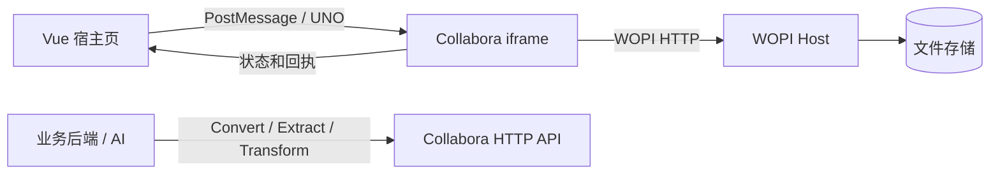
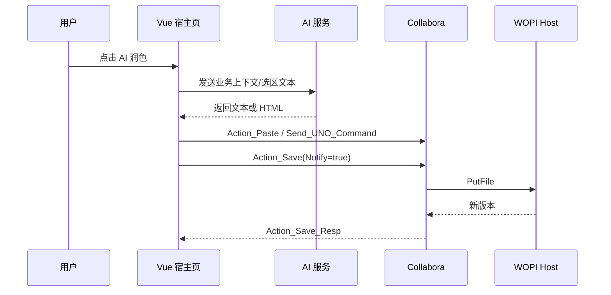

# Collabora Online 核心 API 与文档操作能力梳理

> 适用项目：`Collabora-lingqing-demo`  
> 本机验证版本：Collabora Online Development Edition `26.04.3.1`  
> 整理日期：2026-08-20

## 1. 结论先行

Collabora Online 不是一个“前端富文本 SDK”。宿主系统不能直接访问 iframe 内部 DOM，也不应该把 Collabora 当成可随意读取、修改节点的 JavaScript 编辑器。

它向业务系统提供四类接口：

| 接口层 | 调用方向 | 主要用途 |
| --- | --- | --- |
| WOPI REST | Collabora -> 业务后端 | 获取文件信息、读取文件、保存文件、锁、另存为、重命名 |
| PostMessage API | 宿主页 <-> Collabora iframe | 保存、导出、打印、插入内容、执行 UNO 命令、监听编辑状态 |
| UNO Command | 宿主页 -> Collabora/LibreOffice Core | 操作当前光标或选区，如插字、加粗、撤销、插书签 |
| HTTP 批处理 API | 业务后端 -> Collabora | 格式转换、结构提取、结构化变换、缩略图 |

对本项目而言：

- WOPI 负责“文件生命周期与持久化”。
- PostMessage 负责“控制正在打开的编辑器”。
- UNO 负责“操作当前光标/选区”。
- Extract/Transform 适合“后端或 AI 对文档副本做确定性结构处理”。



## 2. 当前运行环境

本机 `/hosting/capabilities` 返回的关键信息：

```json
{
  "productName": "Collabora Online Development Edition",
  "productVersion": "26.04.3.1",
  "convert-to": {
    "available": true,
    "endpoint": "/cool/convert-to"
  },
  "hasWopiAccessCheck": true,
  "hasDocumentSigningSupport": true,
  "hasMobileSupport": true
}
```

可以用下面的命令随时重新确认：

```bash
curl http://localhost:9980/hosting/capabilities
```

## 3. WOPI REST API

### 3.1 角色关系

在 WOPI 协议中：

- 当前 Vue/Node 项目是 **WOPI Host**，负责文件、权限、版本和 token。
- Collabora Online 是 **WOPI Client**，主动回调 Host 获取或保存文档。
- 浏览器不会直接把 DOCX 交给 iframe；iframe 拿到 `WOPISrc + access_token` 后，由 Collabora 服务端访问 WOPI Host。

### 3.2 最小可编辑接口

| 操作 | HTTP | 路径 | 作用 | 当前项目 |
| --- | --- | --- | --- | --- |
| `CheckFileInfo` | GET | `/wopi/files/:id` | 返回文件名、大小、版本、用户权限和宿主能力 | 已实现 |
| `GetFile` | GET | `/wopi/files/:id/contents` | 返回完整文件二进制 | 已实现 |
| `PutFile` | POST | `/wopi/files/:id/contents` | 接收 Collabora 保存后的完整文件二进制 | 已实现 |

当前实现位于 `server/collaboraWopiPlugin.mjs`。

#### CheckFileInfo 常用字段

| 字段 | 含义 |
| --- | --- |
| `BaseFileName` | 文件名，扩展名决定编辑器类型 |
| `Size` | 文件字节数 |
| `Version` | 文件版本标识，保存后应更新 |
| `OwnerId` / `UserId` | 文件所有者和当前用户标识 |
| `UserFriendlyName` | 协作界面显示的用户名 |
| `UserCanWrite` | 是否允许编辑 |
| `SupportsUpdate` | 是否支持保存回原文件 |
| `SupportsLocks` | 是否支持 WOPI 锁 |
| `UserCanNotWriteRelative` | `true` 时禁用另存为 |
| `SupportsRename` / `UserCanRename` | 是否支持重命名 |
| `PostMessageOrigin` | 允许与 iframe 通信的宿主页 origin；PostMessage 必需 |
| `HideSaveOption` | 隐藏内置保存 UI，但仍可通过 `Action_Save` 保存 |
| `HideExportOption` / `DisableExport` | 隐藏或禁用导出 |
| `DisableCopy` | 禁止从文档复制 |
| `EnableShare` | 启用分享入口，点击后发出 `UI_Share` |
| `EnableInsertRemoteImage` | 启用由宿主选择远程图片的入口 |

### 3.3 生产环境建议补齐的 WOPI 接口

| 操作 | `X-WOPI-Override` | 用途 | 优先级 |
| --- | --- | --- | --- |
| `Lock` | `LOCK` | 给文件设置锁，避免其他写入者覆盖 | P0 |
| `RefreshLock` | `REFRESH_LOCK` | 延长锁有效期 | P0 |
| `Unlock` | `UNLOCK` | 释放锁 | P0 |
| `GetLock` | `GET_LOCK` | 查询当前锁 | P1 |
| `UnlockAndRelock` | `LOCK` + `X-WOPI-OldLock` | 原子更换锁 | P1 |
| `PutRelativeFile` | `PUT_RELATIVE` | “另存为”新文件 | P1 |
| `RenameFile` | `RENAME_FILE` | 重命名当前文件 | P1 |
| `DeleteFile` | `DELETE` | 删除文件 | 按业务需要 |

当前 Demo 明确返回 `SupportsLocks: false`，适合功能演示，但不适合作为多节点生产存储。生产环境应让锁持久化，并严格处理锁不匹配时的 `409 Conflict` 与 `X-WOPI-Lock` 响应头。

### 3.4 access token

启动 iframe 时推荐用表单 POST 传 token：

```html
<form method="post" target="collabora-frame" action="COLLABORA_URL?WOPISrc=ENCODED_WOPI_SRC">
  <input type="hidden" name="access_token" value="TOKEN" />
  <input type="hidden" name="access_token_ttl" value="UNIX_TIME_MS" />
</form>
```

生产要求：

- token 必须绑定文件、用户、权限和过期时间。
- WOPI Host 每个接口都要校验 token。
- 使用 HTTPS，避免 token 和文档内容被截获。
- 不要在日志中打印完整 token。
- 如果部署要求较高，应验证 Collabora 发来的 WOPI proof 签名。

## 4. PostMessage API

### 4.1 消息格式

```ts
interface CollaboraPostMessage {
  MessageId: string
  SendTime: number
  Values: Record<string, unknown> | null
}
```

发送方法：

```ts
function sendToCollabora(messageId: string, values = {}) {
  iframe.contentWindow?.postMessage(
    JSON.stringify({
      MessageId: messageId,
      SendTime: Date.now(),
      Values: values,
    }),
    collaboraOrigin,
  )
}
```

安全要求：

- `targetOrigin` 必须使用 Collabora 的准确 origin，不能在生产中写 `'*'`。
- 接收消息时同时校验 `event.origin` 和 `event.source === iframe.contentWindow`。
- `CheckFileInfo.PostMessageOrigin` 必须等于宿主页的准确 origin。

### 4.2 初始化握手

Collabora 会发送：

```json
{
  "MessageId": "App_LoadingStatus",
  "Values": { "Status": "Frame_Ready" }
}
```

宿主页必须回复：

```ts
sendToCollabora('Host_PostmessageReady')
```

然后等待：

```json
{
  "MessageId": "App_LoadingStatus",
  "Values": { "Status": "Document_Loaded" }
}
```

在收到 `Document_Loaded` 前，不应执行文档操作。未发送 `Host_PostmessageReady` 时，Collabora 会忽略宿主页的多数 PostMessage 命令。

## 5. 宿主页可以调用的文档操作

### 5.1 保存与文件生命周期

| MessageId | Values | 作用 | 返回/副作用 |
| --- | --- | --- | --- |
| `Action_Save` | `Notify`, `DontTerminateEdit`, `DontSaveIfUnmodified`, `ExtendedData` | 保存当前文档 | 触发 WOPI `PutFile`；`Notify:true` 时返回 `Action_Save_Resp` |
| `Action_SaveAs` | `Filename`, `Notify` | 另存为 | 需要 WOPI `PutRelativeFile` |
| `Action_Close` | 无 | 正常关闭当前文档 | 会处理待保存状态 |
| `Close_Session` | 无 | 文档尚未完全加载时也可关闭会话 | 适合取消加载 |

保存示例：

```ts
sendToCollabora('Action_Save', {
  Notify: true,
  DontTerminateEdit: true,
  DontSaveIfUnmodified: false,
  ExtendedData: 'source=external-toolbar',
})
```

保存回执：

```json
{
  "MessageId": "Action_Save_Resp",
  "Values": {
    "success": true,
    "result": "",
    "errorMsg": "",
    "fileName": "demo.docx"
  }
}
```

`Notify` 没有设置为 `true` 时，不保证收到 `Action_Save_Resp`。

### 5.2 内容插入

| MessageId | Values | 作用 | 注意事项 |
| --- | --- | --- | --- |
| `Action_Paste` | `Mimetype`, `Data` | 在当前光标/选区粘贴纯文本或 HTML | 可替换当前选区；HTML 支持受过滤和外部资源策略影响 |
| `Action_InsertGraphic` | `url`，可附 `filename` | 从 URL 下载并插入图片 | 图片域名必须被 Collabora 允许访问 |
| `Action_InsertLink` | `url` | 插入链接 | 通常作为 `UI_PickLink` 的宿主回调 |
| `Action_InsertMultimedia` | `url` | 插入多媒体 | 文档类型和版本相关 |
| `Send_UNO_Command` | `Command`, `Args` | 执行 LibreOffice UNO 命令 | 见第 7 章 |

插入纯文本：

```ts
sendToCollabora('Action_Paste', {
  Mimetype: 'text/plain;charset=utf-8',
  Data: '由外部系统插入的内容',
})
```

插入 HTML：

```ts
sendToCollabora('Action_Paste', {
  Mimetype: 'text/html;charset=utf-8',
  Data: '<p><strong>重点：</strong>这是插入的 HTML。</p>',
})
```

插入图片：

```ts
sendToCollabora('Action_InsertGraphic', {
  filename: 'diagram.png',
  url: 'https://files.example.com/temp/diagram.png',
})
```

图片地址必须能被 Collabora 容器访问；远程源还要满足 `coolwsd.xml` 的允许列表、CSP 和 TLS 配置。

### 5.3 导出、打印与演示

| MessageId | Values | 作用 |
| --- | --- | --- |
| `Get_Export_Formats` | 无 | 查询当前文档可导出的格式 |
| `Action_Export` | `Format`, `Notify` | 按指定格式下载文档；格式应来自 `Get_Export_Formats_Resp` |
| `Action_Print` | 无 | 打印文档 |
| `Action_Fullscreen` | 无 | 进入全屏 |
| `Action_FullscreenPresentation` | `StartSlideNumber` 或 `CurrentSlide` | 启动 Impress 幻灯片放映 |

不要硬编码所有导出格式，先查询：

```ts
sendToCollabora('Get_Export_Formats')

// 收到 Get_Export_Formats_Resp 后
sendToCollabora('Action_Export', {
  Format: 'pdf',
  Notify: true,
})
```

### 5.4 协作视图

| MessageId | Values | 作用 |
| --- | --- | --- |
| `Get_Views` | 无 | 查询当前文档的活动视图/协作者 |
| `Get_User_State` | 无 | 查询当前用户是否处于 active/idle 状态 |
| `Action_FollowUser` | `Follow`, `ViewId` | 开始或停止跟随某位协作者的视图 |
| `Action_RemoveView` | `ViewId` | 移除指定协作视图；谨慎使用 |

查询响应的 MessageId 通常是在请求名后加 `_Resp`，例如：

- `Get_Views_Resp`
- `Get_Export_Formats_Resp`
- `Get_User_State_Resp`

## 6. 编辑器 UI 控制方法

这些 API 主要改变 Collabora 的界面，不直接改文件内容。

| MessageId | Values | 作用 |
| --- | --- | --- |
| `Hide_Button` / `Show_Button` | `id` | 隐藏/显示工具栏按钮 |
| `Remove_Button` | `id` | 移除动态按钮 |
| `Hide_Menu_Item` / `Show_Menu_Item` | `id` | 隐藏/显示菜单项 |
| `Hide_Command` / `Show_Command` | `id` | 按 UNO command 隐藏/显示对应 UI |
| `Hide_Menubar` / `Show_Menubar` | 无 | 隐藏/显示菜单栏 |
| `Hide_Ruler` / `Show_Ruler` | 无 | 隐藏/显示 Writer 标尺 |
| `Hide_StatusBar` / `Show_StatusBar` | 无 | 隐藏/显示状态栏 |
| `Hide_Sidebar` / `Show_Sidebar` | 可选 `id` | 隐藏/显示侧边栏 |
| `Hide_NotebookTab` / `Show_NotebookTab` | `id` | 隐藏/显示 Notebookbar 页签 |
| `Collapse_Notebookbar` / `Extend_Notebookbar` | 无 | 折叠/展开 Notebookbar |
| `Action_ChangeUIMode` | `Mode` | 在 `classic` 与 `notebookbar` 间切换 |
| `Insert_Button` | `id`, `imgurl`, `hint`, `label`, `insertBefore`, `unoCommand` 等 | 插入自定义工具栏按钮 |
| `Insert_ContextualButton` | `id`, `imgurl`, `hint`, `unoCommand` | 插入选区上下文按钮 |
| `Remove_Statusbar_Element` | `id` | 删除状态栏元素 |
| `Grab_Focus` | 无 | 把焦点恢复给编辑器 |
| `Action_ShowBusy` / `Action_HideBusy` | `Label` / 无 | 显示/隐藏处理中遮罩 |
| `Disable_Default_UIAction` | `action`, `disable` | 拦截默认 `UI_Save` 或 `UI_Close` 行为 |

自定义按钮示例：

```ts
sendToCollabora('Insert_Button', {
  id: 'lingqing-ai-polish',
  imgurl: 'https://app.example.com/icons/ai-polish.svg',
  hint: 'AI 润色',
  label: 'AI 润色',
  insertBefore: 'save',
})
```

用户点击后监听：

```json
{
  "MessageId": "Clicked_Button",
  "Values": { "Id": "lingqing-ai-polish" }
}
```

如果 `Insert_Button` 设置了 `unoCommand`，点击会直接执行 UNO 命令，不再发送 `Clicked_Button`。

## 7. Send_UNO_Command

### 7.1 基本格式

```ts
sendToCollabora('Send_UNO_Command', {
  Command: '.uno:Bold',
  Args: {},
})
```

参数值通常使用 UNO 类型包装：

```json
{
  "PropertyName": {
    "type": "string",
    "value": "value"
  }
}
```

常见类型包括 `string`、`boolean`、`long`、`double`。具体属性名和类型由对应 UNO command 决定。

### 7.2 Writer 常用命令

| UNO Command | 作用 | 是否需要 Args |
| --- | --- | --- |
| `.uno:InsertText` | 在当前光标插入文字或替换当前选区 | `Text` |
| `.uno:Bold` | 切换粗体 | 否 |
| `.uno:Italic` | 切换斜体 | 否 |
| `.uno:Underline` | 切换下划线 | 否 |
| `.uno:Strikeout` | 切换删除线 | 否 |
| `.uno:Undo` / `.uno:Redo` | 撤销/重做 | 否 |
| `.uno:SelectAll` | 全选 | 否 |
| `.uno:GoToStartOfDoc` / `.uno:GoToEndOfDoc` | 跳到文档开头/结尾 | 否 |
| `.uno:LeftPara` | 段落左对齐 | 否 |
| `.uno:CenterPara` | 段落居中 | 否 |
| `.uno:RightPara` | 段落右对齐 | 否 |
| `.uno:JustifyPara` | 段落两端对齐 | 否 |
| `.uno:DefaultBullet` | 切换项目符号 | 否 |
| `.uno:DefaultNumbering` | 切换编号列表 | 否 |
| `.uno:InsertPagebreak` | 插入分页符 | 通常不需要 |
| `.uno:InsertBookmark` | 插入书签 | `Bookmark`, `BookmarkText` |
| `.uno:InsertAnnotation` | 插入批注 | 参数随版本和文档类型变化 |
| `.uno:TrackChanges` | 切换修订记录 | 否 |
| `.uno:ShowTrackedChanges` | 显示/隐藏修订 | 否 |

插入文字：

```ts
sendToCollabora('Send_UNO_Command', {
  Command: '.uno:InsertText',
  Args: {
    Text: {
      type: 'string',
      value: '插入到当前光标或替换当前选区',
    },
  },
})
```

插入书签：

```ts
sendToCollabora('Send_UNO_Command', {
  Command: '.uno:InsertBookmark',
  Args: {
    Bookmark: { type: 'string', value: 'section-1' },
    BookmarkText: { type: 'string', value: '第一节' },
  },
})
```

### 7.3 UNO 的边界

- Collabora 只支持 LibreOffice UNO 命令的一个子集，支持情况还取决于 Writer、Calc 或 Impress。
- 多数 UNO 命令围绕“当前光标/当前选区”工作，不是稳定的绝对位置文档 API。
- 不能假设每个 `Send_UNO_Command` 都会返回完成回执；应通过文档状态变化或最终保存结果确认。
- 参数名大小写、类型和 command 名必须完全正确。
- 对复杂表格、样式、查找替换等操作，应先在当前 Collabora 版本上做兼容测试。
- 不要访问 iframe 内部对象或 `window.app` 等内部实现；它们不是稳定公共 API。

## 8. Collabora 发给宿主页的重要事件

| MessageId | 触发时机 | 关键 Values |
| --- | --- | --- |
| `App_LoadingStatus` | iframe 初始化和文档加载阶段 | `Status`: `Initialized`、`Frame_Ready`、`Document_Loaded`、`Failed` |
| `Action_Load_Resp` | 文档加载完成或失败 | `success`, `result`, `errorMsg`, `errorType` |
| `Doc_ModifiedStatus` | 文档脏状态变化 | `Modified` |
| `Action_Save_Resp` | `Action_Save/SaveAs` 且 `Notify:true` 后 | `success`, `result`, `errorMsg`, `fileName` |
| `UI_Save` | 用户点击 Collabora 保存按钮 | 可用于业务审计或接管保存 |
| `UI_Close` | 用户点击关闭 | 宿主可处理页面关闭 |
| `UI_SaveAs` | 用户请求另存为 | 宿主实现文件命名或目录选择 |
| `UI_Share` | 用户点击分享 | 宿主打开业务分享面板 |
| `UI_InsertGraphic` | 用户请求从宿主选择图片 | 选好后回复 `Action_InsertGraphic` |
| `UI_PickLink` | 用户请求从宿主选择链接 | 选好后回复 `Action_InsertLink` |
| `UI_InsertFile` | 用户请求从宿主选择文件 | 按其 `callback` 回复相应 Action |
| `UI_InsertAIContent` | 用户请求 AI 内容 | 宿主打开 AI 面板，之后用 Paste/UNO 写回 |
| `Clicked_Button` | 点击宿主插入的按钮 | `Id` |
| `Clicked_ContextualButton` | 点击宿主插入的上下文按钮 | `Id` |
| `Views_List` | 协作视图列表变化 | 协作者数组 |
| `Session_Closed` | 会话被关闭 | `Reason` |

事件监听示例：

```ts
window.addEventListener('message', (event) => {
  if (event.origin !== collaboraOrigin) return
  if (event.source !== iframe.contentWindow) return

  const message = typeof event.data === 'string'
    ? JSON.parse(event.data)
    : event.data

  switch (message.MessageId) {
    case 'Doc_ModifiedStatus':
      console.log('是否有未保存修改：', message.Values.Modified)
      break
    case 'Action_Save_Resp':
      console.log('保存结果：', message.Values.success)
      break
  }
})
```

## 9. HTTP 批处理 API

这些 API 不操作正在打开的 iframe 会话，而是接收一个上传的文档文件并返回处理结果。

### 9.1 格式转换：Convert-to

当前本机服务已声明可用。

```bash
curl -F "data=@input.docx" \
  http://localhost:9980/cool/convert-to/pdf \
  --output output.pdf
```

用途：

- DOCX 转 PDF
- 文档预览图
- Office 格式互转
- 后端批量导出

它不是 WOPI 保存操作，不会自动修改业务存储中的原文件。

### 9.2 结构提取：Extract Document Structure

```bash
curl -F "data=@input.docx" \
  -F "filter=contentcontrol" \
  http://localhost:9980/cool/extract-document-structure \
  --output structure.json
```

常见过滤器：

| filter | 内容 |
| --- | --- |
| `contentcontrol` | Writer 内容控件 |
| `charts` | 图表数据 |
| `docprops` | 文档属性 |
| `trackchanges` | 修订记录 |
| `slides` | Impress 幻灯片结构 |

官方建议设置 filter；不设置时会提取全部已支持结构，而未来版本增加字段可能影响调用方解析。

### 9.3 结构变换：Transform Document Structure

```bash
curl -F "data=@input.docx" \
  -F "format=docx" \
  -F 'transform={"Transforms":{"ContentControls.ByIndex.1":{"content":"新内容"}}}' \
  http://localhost:9980/cool/transform-document-structure \
  --output transformed.docx
```

适合场景：

- 填充合同或报告模板中的内容控件。
- 修改图表数据。
- 修改文档属性。
- 处理修订记录。
- 对演示文稿的幻灯片做结构化操作。

限制：

- 它不是任意 Word XML/任意自然语言段落的通用修改器。
- 接口处理的是上传的文件副本，不会直接改正在编辑的 iframe 会话。
- 若用于在线文档，推荐流程是：先 `Action_Save` -> 从存储取得最新版 -> Transform -> 作为新版本写入存储 -> 通知用户重新加载。
- Transform JSON 在不同 Collabora 版本间可能演进，必须做版本测试。

### 9.4 其他批处理能力

| API | 用途 |
| --- | --- |
| `/cool/get-thumbnail` | 生成文档或指定元素的缩略图 |
| Extract link targets | 提取表格、图片、书签等可跳转目标 |
| 文档签名能力 | 当前服务声明支持，需配合 WOPI 用户私有签名信息配置 |

批处理 API 应由业务后端调用，不建议直接暴露给公网浏览器。应配置来源允许列表、限流、文件大小限制和任务超时。

## 10. AI 文档操作如何选 API

| AI 场景 | 推荐方式 | 原因 |
| --- | --- | --- |
| 在当前光标插入生成内容 | `Action_Paste` 或 `.uno:InsertText` | 简单、即时 |
| 替换用户当前选区 | `Action_Paste` 或 `.uno:InsertText` | 命令会作用于当前选区 |
| AI 润色并保留基础富文本 | `Action_Paste` + `text/html` | 比纯文本能保留有限格式 |
| AI 填写合同/模板字段 | Transform Document Structure + 内容控件 | 定位更确定、可后端批处理 |
| AI 修改图表或演示文稿结构 | Extract + Transform | 有结构化 JSON 输入输出 |
| 按章节 ID 精确修改任意段落 | 仅 PostMessage/UNO 不足 | 建议使用内容控件/书签设计模板，或在服务端修改 DOCX |
| 读取用户当前选中的任意复杂内容 | 标准 PostMessage 能力有限 | 不应依赖 iframe DOM 或内部对象 |

### 10.1 推荐的 AI 交互链路



## 11. 当前项目已实现情况

### 已实现

- iframe 表单启动与 `access_token`。
- `PostMessageOrigin`。
- `App_LoadingStatus` 初始化状态监听。
- `Host_PostmessageReady` 握手。
- 严格校验 `event.origin` 与 `event.source`。
- `Send_UNO_Command` + `.uno:InsertText`。
- `Action_Save`。
- `Action_Save_Resp`。
- `Doc_ModifiedStatus`。
- WOPI `CheckFileInfo`、`GetFile`、`PutFile`。
- 内存文件版本递增和保存后下载。

### 尚未实现

- WOPI Lock/RefreshLock/Unlock。
- 持久化文件存储和数据库版本。
- `access_token_ttl`、业务登录态与 WOPI proof 验证。
- Save As、Rename、Delete。
- 导出格式查询和 PDF 导出 UI。
- HTML 粘贴、图片插入、链接插入。
- 自定义 Collabora 工具栏按钮。
- 协作者列表与跟随视图。
- Convert/Extract/Transform 的业务后端封装。

## 12. 建议的下一步优先级

1. **P0：持久化与并发安全**  
   把内存 Map 换成对象存储/文件服务，增加文档数据库记录，补齐 WOPI Lock、RefreshLock、Unlock。

2. **P0：鉴权与 HTTPS**  
   token 绑定用户与文档权限、增加 TTL、限制 WOPI Host 和图片下载来源，生产环境全链路 HTTPS。

3. **P1：封装 PostMessage 客户端**  
   将 `save`、`pasteHtml`、`insertImage`、`exportAs`、`getViews` 等封装为带超时和响应匹配的 TypeScript 服务。

4. **P1：接 AI 选区操作**  
   先实现纯文本/HTML 写回；如果要求稳定定位，模板应预埋内容控件或书签，不依赖光标位置猜测。

5. **P2：接 Extract/Transform**  
   用于合同模板填充、结构化报告和演示文稿生成，并锁定、验证当前部署的 Collabora 版本。

## 13. 官方资料

- [Collabora Online SDK Manual](https://sdk.collaboraonline.com/CO-SDK-manual.pdf)
- [Collabora 官方 PostMessage 示例 framed.doc.html](https://github.com/CollaboraOnline/online/blob/main/browser/html/framed.doc.html)
- [Collabora Online SDK Examples](https://github.com/CollaboraOnline/collabora-online-sdk-examples)
- [Collabora Online 源码镜像](https://github.com/CollaboraOnline/online.mirror)
- [Microsoft WOPI REST API Reference](https://learn.microsoft.com/en-us/microsoft-365/cloud-storage-partner-program/rest/)
- [Microsoft WOPI REST Endpoints](https://learn.microsoft.com/en-us/microsoft-365/cloud-storage-partner-program/rest/endpoints)

> 注意：PostMessage、UNO 与 Extract/Transform 都存在版本差异。开发时应以 `/hosting/capabilities`、`/hosting/discovery`、当前版本 SDK 手册和实际回归测试为准。
