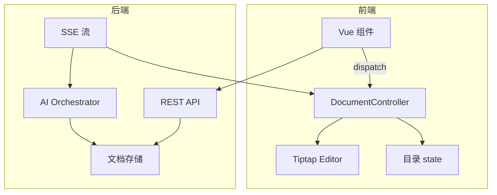

# 灵清文档 Demo — 前后端协作交互方案

> 文档版本：**v1.1**  
> 适用项目：`tiptap-lingqing-demo`（前端 Vue 3 + Tiptap）  
> 目标读者：后端 / AI 服务 / 全栈同学  
> 最后更新：2026-08-18  
> 变更说明：v1.1 补充现状/目标对照、SSE 接入方案、revision 规则、上传/图片 AI、类型附录，修正协议矛盾

---

## 0. 重要说明：目标方案 vs 当前 Demo 现状

**本文档定义的是「目标联调协议」**，不是当前前端已 100% 落地的实现。

| 能力 | 当前 Demo（v1.0 代码） | 目标协议（本文） |
| --- | --- | --- |
| 文档命令层 | `useDocumentStream` composable | `DocumentController` 统一 `dispatch` |
| `docRevision` | ❌ 未实现 | ✅ 必须 |
| 流式事件 | 本地 mock generator | 后端 SSE |
| StreamEvent 字段 | 仅 `type + payload` | 含 `sessionId/seq/baseRevision/error` |
| 选区 AI 写回编辑器 | ❌ 仅更新状态文案 | ✅ `content.replaceRange` |
| 用户编辑持久化 | ❌ 纯前端 | Phase 2：`POST /ops` |
| 批注详情 | 本地 mock 字典 | `GET /api/annotations/:id` |

后端可按 **P0 章节** 先实现接口；前端会按同一协议逐步重构。

---

## 1. 背景与目标

当前 Demo 已具备：

- 目录（TOC）嵌在文档区画布内，与正文标题 **通过 `id` 绑定**
- 目录 ↔ 正文 **双向同步**（改目录名 / 改正文标题）
- AI **流式 mock**（先目录、后正文）
- 选区 AI 操作入口（扩写 / 润色 / 生成图片 / 摘要）
- 批注联动（带 `data-annotation-id` 的下划线文本）

接下来要接真实 AI，并允许 **AI 与用户交替修改** 同一份文档。

**核心原则：**

1. 后端只产出 **StreamEvent / DocumentCommand**，不碰前端组件  
2. 前端只通过 **DocumentController** 改状态  
3. 用户与 AI 走 **同一套命令协议**  
4. 写入携带 **`baseRevision`**，支持冲突检测  

---

## 2. 术语

| 术语 | 说明 |
| --- | --- |
| `documentId` | 文档唯一 ID |
| `docRevision` | 文档版本号；**由后端权威递增**（见 5.4） |
| `headingId` / `nodeId` | 目录项与正文标题绑定 ID，如 `ch2-1` |
| `StreamEvent` | AI 流式推送单条事件（SSE） |
| `DocumentCommand` | 文档原子修改命令 |
| `source` | `user` / `ai` / `system` |
| `sessionId` | 一次 AI 任务 ID |
| `seq` | SSE 事件单调递增序号，用于续传与去重 |

---

## 3. 总体架构



### 3.1 职责划分

| 层级 | 前端 | 后端 |
| --- | --- | --- |
| 展示 | 目录、编辑器、批注、工具栏 | — |
| 状态 | 视图态（TOC + Editor） | 持久化 + revision |
| 编辑 | 执行 Command | 生成 Command / Event |
| 冲突 | 校验 `baseRevision` | 返回带 revision 的写入 |
| 流式 | 消费 SSE | 推送 SSE |

---

## 4. 文档模型与数据源

### 4.1 权威数据源（必须对齐）

| 阶段 | 正文权威源 | 目录权威源 |
| --- | --- | --- |
| 流式生成中 | 累积 HTML buffer（append） | 增量 TOC 树 |
| 流式完成后 | **Tiptap 文档 state** | TOC 树 |
| 持久化 | 后端 `contentHtml` 或 PM JSON（待定） | 后端 `toc` |

**注意：** 当前 Demo 在流式阶段用 `htmlContent` 字符串 + 反复 `setContent`；目标实现应在 `stream.done` 后 **以 Tiptap 为唯一正文源**，避免 `htmlContent` 与 editor 双轨不一致。

### 4.2 TOC

```typescript
interface TocNode {
  id: string
  title: string
  children: TocNode[]
}

interface FlatTocNode {
  id: string
  title: string
  parentId: string | null // null = 挂到根层
}
```

### 4.3 正文 HTML 约束

```html
<h1 id="doc-title">产品技术白皮书</h1>
<h2 id="ch2">二、项目背景</h2>
<p>正文...</p>
<span data-annotation-id="ann-1">批注文本</span>
```

**HTML chunk 规则（流式 append）：**

- 每个 `html` chunk 必须是 **合法、可拼接** 的 HTML 片段  
- 不允许输出未闭合标签（如单独 `<p>` 无 `</p>`）  
- 标题 chunk 必须带与 TOC 一致的 `id`  

### 4.4 文档快照

```typescript
interface DocumentSnapshot {
  documentId: string
  docRevision: number
  toc: TocNode[]
  contentHtml: string
  updatedAt: string
}
```

### 4.5 id 绑定规则

| 规则 | 说明 |
| --- | --- |
| R1 | 每个 TOC 节点唯一 `id` |
| R2 | 正文存在 `<h1\|h2\|h3 id="同 id">` |
| R3 | 改标题文字，`id` 不变 |
| R4 | **`toc.rename` 与 `heading.update` 语义等价**（见 5.2） |

---

## 5. DocumentController 与 revision

### 5.1 DocumentCommand 定义

```typescript
type CommandSource = 'user' | 'ai' | 'system'

interface AnnotationPayload {
  id: string
  quote: string
  author: string
  content: string
  createdAt: string
  anchor?: {
    headingId?: string
    quoteText?: string
    startOffset?: number
    endOffset?: number
  }
}

type DocumentCommand =
  | { type: 'toc.add'; node: FlatTocNode; source: CommandSource; baseRevision?: number }
  | { type: 'toc.rename'; id: string; title: string; source: CommandSource; baseRevision?: number }
  | { type: 'toc.remove'; id: string; source: CommandSource; baseRevision?: number }
  | { type: 'heading.update'; id: string; title: string; source: CommandSource; baseRevision?: number }
  | { type: 'content.append'; html: string; source: CommandSource; baseRevision?: number }
  | { type: 'content.replaceRange'; from: number; to: number; html: string; source: CommandSource; baseRevision?: number }
  | { type: 'content.insertImage'; from: number; to: number; url: string; alt?: string; source: CommandSource; baseRevision?: number }
  | { type: 'annotation.upsert'; annotation: AnnotationPayload; source: CommandSource }
  | { type: 'stream.phase'; phase: StreamPhase; source: 'system' }
  | { type: 'stream.status'; message: string; source: 'system' }

type StreamPhase = 'idle' | 'toc' | 'content' | 'done'
```

### 5.2 目录 ↔ 标题同步（避免重复命令）

**约定：后端只发一种即可**

| 后端发送 | 前端命令层自动同步 |
| --- | --- |
| `toc.rename` | 同步 Tiptap heading 文本 |
| `heading.update` | 同步 TOC 节点 title |

❌ **禁止** 同一次 AI 响应里同时发 `toc.rename` + `heading.update`（重复且可能竞态）。

### 5.3 前端 dispatch 伪代码

```typescript
function dispatch(command: DocumentCommand) {
  if (command.baseRevision != null && command.baseRevision !== state.docRevision) {
    return { ok: false, code: 'REVISION_CONFLICT', currentRevision: state.docRevision }
  }
  apply(command)
  return { ok: true, docRevision: state.docRevision }
}
```

### 5.4 revision 递增规则（P0 必须对齐）

**权威方：后端**。前端不自行递增持久化 revision。

| 场景 | revision 行为 |
| --- | --- |
| 流式 `toc/html` chunk | **不递增**（仅会话内临时 apply） |
| SSE `done` 事件 | 后端给出最终 `docRevision`（如 0→1） |
| 用户 `POST /ops` 成功 | 返回新 `docRevision` |
| 选区 AI 成功 | 返回新 `docRevision` |
| 流式进行中用户编辑 | 见 12 章冲突策略 |

> 说明：若每个 html chunk 都 +1，revision 会暴涨且极易冲突；流式阶段用 `sessionId + seq` 保证顺序，`done` 时再提交最终 revision。

---

## 6. API 一览

| 方法 | 路径 | 用途 | 阶段 |
| --- | --- | --- | --- |
| POST | `/api/files/upload` | 上传源文件，返回 `fileId` | P0 |
| GET | `/api/documents/:documentId` | 获取文档快照 | P1 |
| PUT | `/api/documents/:documentId` | 保存快照 | P1 |
| POST | `/api/documents/:documentId/ops` | 用户编辑 ops | P1 |
| POST | `/api/ai/document-process` | 创建 AI 处理任务 | P0 |
| GET | `/api/ai/sessions/:sessionId/stream` | SSE 拉流（**推荐**） | P0 |
| POST | `/api/ai/document-action` | 选区 AI | P0 |
| POST | `/api/ai/document-commands` | AI 结构化改目录/正文 | P2 |
| GET | `/api/annotations/:annotationId` | 批注详情 | P1 |
| DELETE | `/api/ai/sessions/:sessionId` | 取消 AI 任务 | P0 |

**鉴权（P0 建议）：** 所有接口需登录；校验 `documentId` 归属。  
Header：`Authorization: Bearer <token>` 或 Cookie Session。

**开发代理：** Vite `/api` → `VITE_API_BASE_URL`（默认 `http://localhost:3001`）。

---

## 7. 文件上传（P0）

### POST `/api/files/upload`

`Content-Type: multipart/form-data`

Response:

```json
{
  "ok": true,
  "fileId": "file_abc123",
  "fileName": "需求文档.docx",
  "mimeType": "application/vnd.openxmlformats-officedocument.wordprocessingml.document",
  "size": 102400
}
```

后续 `document-process` 使用 `fileId`。

---

## 8. SSE 接入方案（P0 阻塞项）

### 8.1 为什么不用「POST + EventSource」

浏览器原生 `EventSource` **仅支持 GET**。  
若坚持 `POST /document-process` 直接返回 SSE，前端必须用 **`fetch + ReadableStream`** 解析。

### 8.2 推荐方案（A）：创建任务 + GET 拉流

```text
1. POST /api/ai/document-process  → 返回 { sessionId, docRevision }
2. GET  /api/ai/sessions/:sessionId/stream  → SSE（可用 EventSource）
```

**Step 1 Response（JSON，非 SSE）：**

```json
{
  "ok": true,
  "sessionId": "sess_xxx",
  "baseRevision": 0,
  "locks": {
    "mode": "append-only",
    "allowedCommands": ["toc.add", "content.append"]
  }
}
```

**Step 2 SSE Headers：**

```http
Content-Type: text/event-stream
Cache-Control: no-cache
Connection: keep-alive
X-Accel-Buffering: no
```

**SSE 格式：**

```text
id: 6
event: stream
data: {"type":"done","docRevision":1,"sessionId":"sess_xxx","seq":6}

: ping
```

| 字段 | 说明 |
| --- | --- |
| `id:` | 等于 `seq`，用于 `Last-Event-ID` 续传 |
| `event:` | 固定 `stream` |
| `data:` | JSON 字符串 |
| `: ping` | 心跳，建议 15~30s |

**断线续传：**

```http
GET /api/ai/sessions/sess_xxx/stream
Last-Event-ID: 6
```

后端从 `seq > 6` 继续推送（或返回 410 需重开任务）。

### 8.3 备选方案（B）：POST 直接 SSE

`POST /api/ai/document-process` 返回 `text/event-stream`。  
前端用 fetch 读流，**不能使用 EventSource**。  
若选 B，需在联调文档中明确，并提供前端解析示例（附录 C）。

**本文 P0 默认采用方案 A。**

---

## 9. StreamEvent 协议

```typescript
interface StreamEventBase {
  sessionId: string
  seq: number
  baseRevision?: number
}

type StreamEvent =
  | ({ type: 'status'; message: string } & StreamEventBase)
  | ({ type: 'phase'; phase: StreamPhase } & StreamEventBase)
  | ({ type: 'toc'; node: FlatTocNode } & StreamEventBase)
  | ({ type: 'html'; chunk: string } & StreamEventBase)
  | ({ type: 'annotation.upsert'; annotation: AnnotationPayload; targetHtml?: string } & StreamEventBase)
  | ({ type: 'command'; command: DocumentCommand } & StreamEventBase)
  | ({ type: 'done'; docRevision: number } & StreamEventBase)
  | ({ type: 'error'; code: string; message: string } & StreamEventBase)
```

**首条事件必须包含 `sessionId` 与 `seq=1`。**

### 9.1 推送顺序

```text
status → phase:toc → toc×N → status → phase:content → html×M → [annotation.upsert×K] → phase:done → done(docRevision)
```

### 9.2 前端映射

```typescript
for await (const event of sse) {
  switch (event.type) {
    case 'toc':
      dispatch({ type: 'toc.add', node: event.node, source: 'ai' })
      break
    case 'html':
      dispatch({ type: 'content.append', html: event.chunk, source: 'ai' })
      break
    case 'annotation.upsert':
      dispatch({ type: 'annotation.upsert', annotation: event.annotation, source: 'ai' })
      break
    case 'done':
      state.docRevision = event.docRevision // 后端权威
      dispatch({ type: 'stream.phase', phase: 'done', source: 'system' })
      break
    case 'error':
      stopStream(event.code, event.message)
      break
  }
}
```

---

## 10. 场景：AI 全文处理

### POST `/api/ai/document-process`

Request:

```json
{
  "documentId": "doc_001",
  "baseRevision": 0,
  "source": { "type": "upload", "fileId": "file_abc123" },
  "options": {
    "language": "zh-CN",
    "generateToc": true,
    "generateAnnotations": true
  }
}
```

Response：见 8.2 Step 1（JSON + `sessionId`）。

---

## 11. 场景：用户编辑

### Phase 1

纯前端 `dispatch`，不调后端（Demo 现状）。

### Phase 2 — POST `/api/documents/:documentId/ops`

```json
{
  "baseRevision": 12,
  "ops": [
    {
      "type": "toc.rename",
      "id": "ch2-1",
      "title": "2.1 行业现状分析",
      "source": "user",
      "clientOpId": "op_001"
    },
    {
      "type": "content.replaceRange",
      "from": 500,
      "to": 520,
      "html": "用户修改后的段落文本",
      "source": "user",
      "clientOpId": "op_002"
    }
  ]
}
```

Response：

```json
{ "ok": true, "docRevision": 13, "appliedOps": ["op_001", "op_002"] }
```

冲突 409：

```json
{
  "ok": false,
  "code": "REVISION_CONFLICT",
  "currentRevision": 15,
  "message": "文档已被修改，请刷新后重试"
}
```

**定位建议：** 除 `from/to` 外，支持 `headingId + quoteText` 作为备用定位，避免偏移漂移。

---

## 12. 场景：选区 AI

### POST `/api/ai/document-action`

Request（目标协议；与当前 Demo 请求体不同）：

```json
{
  "documentId": "doc_001",
  "sessionId": "sess_action_001",
  "baseRevision": 13,
  "action": "polish",
  "selection": {
    "text": "用户在阅读长文档时难以快速定位重点",
    "from": 1280,
    "to": 1302,
    "headingId": "ch2-2"
  },
  "context": {
    "contentHtml": "...",
    "toc": []
  }
}
```

**action 枚举：** `expand` | `polish` | `summarize` | `generate-image`

### 12.1 文本类结果（expand / polish / summarize）

```json
{
  "ok": true,
  "docRevision": 14,
  "message": "润色完成",
  "result": {
    "type": "replaceRange",
    "from": 1280,
    "to": 1302,
    "html": "用户在阅读长文档时往往难以及时定位关键信息"
  }
}
```

前端：

```typescript
dispatch({
  type: 'content.replaceRange',
  from, to, html,
  source: 'ai',
  baseRevision: 13,
})
```

### 12.2 图片类结果（generate-image）

```json
{
  "ok": true,
  "docRevision": 14,
  "message": "图片已生成",
  "result": {
    "type": "insertImage",
    "from": 1280,
    "to": 1302,
    "url": "https://cdn.example.com/ai/img_xxx.png",
    "alt": "示意图"
  }
}
```

前端映射为 `content.insertImage`（Tiptap Image 节点或 ``）。

### 12.3 流式选区 AI（P2，可选）

SSE 推送 delta，最后：

```json
{
  "type": "done",
  "docRevision": 14,
  "result": { "type": "replaceRange", "from": 1280, "to": 1302, "html": "..." }
}
```

---

## 13. 场景：AI 结构化命令（P2）

### POST `/api/ai/document-commands`

Response **只发一种 rename 命令**：

```json
{
  "ok": true,
  "docRevision": 15,
  "commands": [
    {
      "type": "toc.rename",
      "id": "ch2",
      "title": "二、项目背景与研究意义",
      "source": "ai"
    }
  ]
}
```

---

## 14. 批注

### GET `/api/annotations/:annotationId`

```json
{
  "id": "ann-1",
  "quote": "用户在阅读长文档时难以快速定位重点",
  "author": "AI 审阅",
  "content": "建议补充用户调研数据…",
  "createdAt": "2026-08-18T09:42:00+08:00",
  "anchor": {
    "headingId": "ch2-2",
    "quoteText": "用户在阅读长文档时难以快速定位重点"
  }
}
```

**定位优先级：** `data-annotation-id`（HTML 点击） > `quoteText` + `headingId` > offset。

### 流式 upsert

```json
{
  "type": "annotation.upsert",
  "sessionId": "sess_xxx",
  "seq": 12,
  "annotation": { "id": "ann-4", "quote": "...", "content": "...", "author": "AI", "createdAt": "..." },
  "targetHtml": "<span data-annotation-id=\"ann-4\">...</span>"
}
```

前端：先 `annotation.upsert`，再将 `targetHtml` 合并进正文（或通过 `content.replaceRange`）。

---

## 15. 人机混改与冲突

### 15.1 流式会话锁

任务创建响应中的 `locks`：

```json
{
  "mode": "append-only",
  "allowedCommands": ["toc.add", "content.append", "annotation.upsert"]
}
```

| 模式 | 流式期间允许 |
| --- | --- |
| append-only | AI 追加；用户只读/滚动/选中 |
| 用户改标题 | 需提示或进入 conflict 队列（产品决策，见 17） |

### 15.2 冲突处理

1. **seq 去重**：仅接受 `seq > lastSeq`  
2. **revision 校验**：流式结束后 `done.docRevision` 与用户本地不一致 → 拉快照  
3. **过期 chunk 丢弃**：`baseRevision` 落后则忽略并计数告警  
4. **diff 确认（P2）**：`REVISION_CONFLICT` 返回 `userVersion` vs `aiProposal`  

### 15.3 取消任务

`DELETE /api/ai/sessions/:sessionId` 后，SSE 发送：

```json
{ "type": "error", "code": "SESSION_CANCELLED", "message": "任务已取消", "sessionId": "...", "seq": 99 }
```

---

## 16. 错误码

| code | HTTP | 说明 |
| --- | --- | --- |
| `REVISION_CONFLICT` | 409 | 版本冲突 |
| `SESSION_NOT_FOUND` | 404 | 会话不存在 |
| `SESSION_CANCELLED` | 409 | 已取消 |
| `INVALID_NODE_ID` | 400 | 目录 id 无效 |
| `INVALID_HTML` | 400 | HTML 非法 |
| `AI_TIMEOUT` | 504 | AI 超时 |
| `AI_RATE_LIMIT` | 429 | 限流 |
| `UNAUTHORIZED` | 401 | 未登录 |
| `FORBIDDEN` | 403 | 无文档权限 |

---

## 17. P0 阻塞决策清单（联调前必须确认）

| # | 决策项 | 建议 | 状态 |
| --- | --- | --- | --- |
| 1 | SSE 方案 | **A：POST 创建 + GET 拉流** | ⬜ 待确认 |
| 2 | revision 权威 | **后端递增**；流式 chunk 不递增 | ⬜ 待确认 |
| 3 | 正文存储 | 短期 HTML；中长期可 PM JSON | ⬜ 待确认 |
| 4 | 选区定位 | `from/to` + 备用 `headingId+quoteText` | ⬜ 待确认 |
| 5 | 目录 rename | 后端 **只发 `toc.rename`** | ⬜ 待确认 |
| 6 | 流式中用户编辑 | 默认禁止改标题；或允许但丢弃冲突 chunk | ⬜ 待确认 |

---

## 18. 联调优先级

### P0

- 上传、创建任务、GET SSE、取消会话  
- StreamEvent：`status/phase/toc/html/done/error`  
- 选区 AI 文本 `replaceRange` + 图片 `insertImage`  
- 标题 `id` 与 TOC 一致  

### P1

- 文档快照、用户 ops、批注 GET、SSE seq 续传  

### P2

- document-commands、冲突 diff、协同编辑  

---

## 19. curl 示例

### 上传

```bash
curl -X POST "http://localhost:3001/api/files/upload" \
  -H "Authorization: Bearer <token>" \
  -F "file=@./demo.docx"
```

### 创建 AI 任务

```bash
curl -X POST "http://localhost:3001/api/ai/document-process" \
  -H "Authorization: Bearer <token>" \
  -H "Content-Type: application/json" \
  -d '{
    "documentId": "doc_001",
    "baseRevision": 0,
    "source": { "type": "upload", "fileId": "file_demo" }
  }'
```

### SSE 拉流

```bash
curl -N "http://localhost:3001/api/ai/sessions/sess_demo_001/stream" \
  -H "Authorization: Bearer <token>" \
  -H "Accept: text/event-stream"
```

---

## 附录 A：类型与代码映射

| 目标协议 | 当前 Demo 文件 | 状态 |
| --- | --- | --- |
| StreamEvent v1.1 | `src/types/document.ts` | 待升级 |
| DocumentController | `src/composables/useDocumentStream.ts` | 待重构 |
| SSE 客户端 | 无 | 待新增 |
| 选区 AI 写回 | `src/services/aiDocumentService.ts` | 待升级 |
| 批注 | `src/mock/mockAnnotations.ts` | 待接 API |

---

## 附录 B：当前 Demo 请求体（过渡期）

`POST /api/ai/document-action` 当前前端实际发送：

```json
{
  "action": "polish",
  "text": "选中文本",
  "from": 1280,
  "to": 1302
}
```

后端 MVP 可暂时兼容此格式，但应尽快迁移到第 12 章完整请求体。

---

## 附录 C：POST 直接 SSE 的前端解析片段（方案 B）

```typescript
const res = await fetch('/api/ai/document-process', { method: 'POST', body: JSON.stringify(body) })
const reader = res.body!.getReader()
const decoder = new TextDecoder()
let buffer = ''

while (true) {
  const { done, value } = await reader.read()
  if (done) break
  buffer += decoder.decode(value, { stream: true })
  // 按 \n\n 解析 SSE 帧，提取 data: 行 JSON
}
```

---

## 附录 D：自审记录（v1.1）

| 检查项 | 结果 |
| --- | --- |
| 目标 vs 现状是否明确 | ✅ 第 0 章 |
| SSE POST/EventSource 矛盾 | ✅ 已改推荐方案 A |
| revision 递增规则 | ✅ 5.4 明确后端权威、chunk 不递增 |
| 5.2 与结构化命令示例矛盾 | ✅ 13 章仅 `toc.rename` |
| StreamEvent 与批注事件一致 | ✅ 9 章含 `annotation.upsert` |
| generate-image 协议 | ✅ 12.2 |
| 上传 API | ✅ 第 7 章 |
| API 表含 document-commands | ✅ 第 6 章 |
| 双数据源说明 | ✅ 4.1 |
| 鉴权/心跳/续传/取消 | ✅ 8.2、15.3 |
| AnnotationPayload 定义 | ✅ 5.1 |
| 非标题编辑 ops | ✅ 11 Phase 2 |
| 附录 B 过渡兼容 | ✅ |

**残留风险（需产品/后端最终确认）：** 流式期间是否允许用户编辑；长期存储 HTML vs PM JSON（见 17 章）。

---

## 20. 联系方式

- 仓库：`tiptap-lingqing-demo`
- 类型：`src/types/document.ts`、`src/types/aiAction.ts`、`src/types/annotation.ts`
- Mock：`src/mock/mockDocumentStream.ts`

协议变更请升版本号并更新「附录 D 自审记录」。
