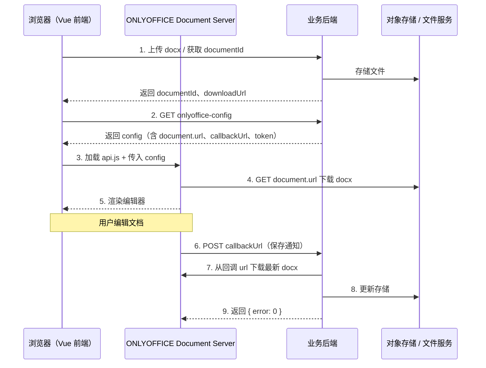

# ONLYOFFICE 文档编辑器 — 后端对接说明

> **文档版本**：v1.0  
> **适用项目**：lingqing 文档编辑器 Demo（前端 Vue 3 + ONLYOFFICE）  
> **目标读者**：后端 / 运维 / 架构  
> **最后更新**：2026-08-18

---

## 1. 背景与目标

前端已完成 ONLYOFFICE 集成，用于 **Word（.docx）文档的展示与编辑**。  
与纯浏览器方案（如 SuperDoc）不同，ONLYOFFICE 采用 **「前端 + Document Server + 业务后端」** 三层架构：

| 层级 | 职责 |
|------|------|
| **前端（Vue）** | 嵌入编辑器 iframe、目录树 UI、AI 助手面板、上传/加载流程 |
| **ONLYOFFICE Document Server** | 提供编辑器 UI、渲染 docx、处理协同/保存，由 Document Server 拉取文档 URL |
| **业务后端** | 文档存储、上传下载、生成 ONLYOFFICE 配置、接收保存回调、（可选）JWT 签名 |

**当前 Demo 状态**：

- ✅ 前端已接入 `@onlyoffice/document-editor-vue`
- ✅ 开发环境可通过 `docker-compose` 本地启动 Document Server
- ⚠️ 编辑器配置（config）目前由**前端 mock** 生成（`src/services/onlyofficeConfig.ts`）
- ⚠️ 用户上传的本地 `.docx` **无法**被 ONLYOFFICE 直接打开（缺少后端可访问 URL）
- ⚠️ 保存回调 `callbackUrl` 指向 mock 地址，**尚未实现真实写回**

**联调目标**：后端提供文档存储 + ONLYOFFICE 配置接口 + 保存回调后，前端改为调用后端 API，完成「上传 → 编辑 → 保存」闭环。

---

## 2. 整体架构



### 2.1 网络访问关系（部署时必须满足）

```
浏览器 ──► 前端静态资源（如 https://app.example.com）
浏览器 ──► Document Server（如 https://doc-server.example.com）
Document Server ──► document.url（文档下载地址，必须 DS 能访问）
Document Server ──► callbackUrl（保存回调，必须 DS 能 POST）
业务后端 ──► （可选）Document Server 内网地址
```

**常见误区**：

- ❌ 把 `document.url` 设为仅浏览器可访问的 `blob:` / 前端临时 URL
- ❌ 在 Docker 内的 Document Server 使用 `http://localhost:3001/...`（容器内 localhost 不是宿主机）
- ✅ 使用 Document Server **所在网络能访问** 的内网域名、IP 或 `host.docker.internal`（开发）

---

## 3. Document Server 部署

### 3.1 开发环境（本项目已提供）

项目根目录 `docker-compose.yml`：

```yaml
services:
  onlyoffice:
    image: onlyoffice/documentserver:8.2
    container_name: onlyoffice-lingqing-ds
    ports:
      - '8080:80'
    environment:
      JWT_ENABLED: 'false'          # 开发可关闭；生产必须开启并由后端签名
      ALLOW_PRIVATE_IP_ADDRESS: 'true'
      ALLOW_META_IP_ADDRESS: 'true'
```

启动命令：

```bash
pnpm onlyoffice:up      # docker compose up -d
pnpm onlyoffice:logs    # 查看日志
pnpm onlyoffice:down    # 停止
```

验证 Document Server 是否正常：

```bash
curl -I http://localhost:8080/web-apps/apps/api/documents/api.js
# 期望：HTTP/1.1 200 OK
```

前端环境变量：

```env
VITE_ONLYOFFICE_SERVER_URL=http://localhost:8080
```

若前端报 **「无法加载 ONLYOFFICE API：.../api.js」**，说明 Document Server **未启动** 或地址/端口不可达。

### 3.2 生产环境建议

| 项 | 建议 |
|----|------|
| 部署方式 | Docker / K8s / 官方安装包 |
| 访问 | 独立域名 + HTTPS，如 `https://doc-server.example.com` |
| JWT | **必须开启** `JWT_ENABLED=true`，由后端用 secret 签名 config |
| 反向代理 | Nginx 配置 WebSocket、大文件超时、CORS（若跨域） |
| 资源 | 建议 4C8G 起，并发编辑时按 ONLYOFFICE 官方容量规划 |

---

## 4. 后端需提供的 API

以下接口为**建议命名**，可按现有 REST 规范调整，但**语义与 ONLYOFFICE 要求的数据字段**需保持一致。

### 4.1 上传 Word 文档

**用途**：用户在前端选择 `.docx` 后，后端持久化并返回 Document Server 可下载的 URL。

```
POST /api/documents/upload
Content-Type: multipart/form-data
```

**请求体**：

| 字段 | 类型 | 必填 | 说明 |
|------|------|------|------|
| file | File | 是 | `.docx` 文件 |
| projectId / bizId | string | 否 | 业务关联 ID（按实际业务） |

**响应示例**：

```json
{
  "documentId": "doc-20250818-001",
  "fileName": "军检记录.docx",
  "title": "军检记录",
  "downloadUrl": "https://api.example.com/api/documents/doc-20250818-001/download",
  "version": 1,
  "fileType": "docx"
}
```

**要求**：

1. `downloadUrl` 必须允许 **ONLYOFFICE Document Server** 发起 HTTP GET（无需浏览器 Cookie 的方式，或使用 DS 可携带的鉴权方式）。
2. 若需鉴权，推荐：**短期签名 URL**（如 OSS 预签名，有效期 15～60 分钟），并在生成 config 时刷新。
3. 单文件大小限制建议与前端一致：**≤ 20MB**（前端当前校验逻辑，可协商调整）。

---

### 4.2 获取 ONLYOFFICE 编辑器配置（核心接口）

**用途**：前端打开编辑器前调用，替代当前前端 mock（`buildOnlyOfficeConfig`）。

```
GET /api/documents/{documentId}/onlyoffice-config
```

**Query 参数**：

| 参数 | 类型 | 必填 | 说明 |
|------|------|------|------|
| mode | `edit` \| `view` | 否 | 默认 `edit` |

**响应结构**（符合 [ONLYOFFICE Config API](https://api.onlyoffice.com/docs/docs-api/usage-api/config/)）：

```json
{
  "documentType": "word",
  "document": {
    "title": "军检记录.docx",
    "url": "https://api.example.com/api/documents/doc-20250818-001/download?token=xxx",
    "fileType": "docx",
    "key": "doc-20250818-001-v1",
    "permissions": {
      "edit": true,
      "download": true,
      "print": true,
      "review": true,
      "comment": true
    }
  },
  "editorConfig": {
    "callbackUrl": "https://api.example.com/api/onlyoffice/callback",
    "user": {
      "id": "user-zhang-001",
      "name": "张工"
    },
    "lang": "zh-CN",
    "mode": "edit",
    "customization": {
      "autosave": true,
      "forcesave": true,
      "compactHeader": false,
      "compactToolbar": false
    }
  },
  "token": "eyJhbGciOiJIUzI1NiIsInR5cCI6IkpXVCJ9..."
}
```

#### 字段说明（重点）

| 字段 | 说明 |
|------|------|
| `document.url` | Document Server 下载 docx 的地址，**必须 DS 可访问** |
| `document.key` | 文档会话唯一标识；**内容变更后必须更新**（如 `docId-v{version}`），否则编辑器可能缓存旧版 |
| `document.fileType` | 扩展名，Word 固定 `docx` |
| `editorConfig.callbackUrl` | 保存时 Document Server POST 的地址 |
| `editorConfig.user` | 当前用户信息（协同、批注显示用） |
| `editorConfig.mode` | `edit` 编辑 / `view` 只读预览 |
| `token` | **生产环境 JWT 开启时必填**，对整个 config 签名 |

**前端当前 mock 参考**（联调时可对照）：

- 源码：`src/services/onlyofficeConfig.ts`
- 类型：`src/types/onlyoffice.ts`

联调后前端将改为：

```typescript
// 伪代码
const config = await fetch(`/api/documents/${documentId}/onlyoffice-config?mode=edit`)
// Document Server 地址仍由前端 env 传入组件：VITE_ONLYOFFICE_SERVER_URL
```

---

### 4.3 文档下载（若 upload 返回的是 API 路径）

**用途**：作为 `document.url` 提供给 Document Server。

```
GET /api/documents/{documentId}/download
```

**要求**：

- Document Server 发起请求时能成功返回 `application/vnd.openxmlformats-officedocument.wordprocessingml.document`
- 不要使用「仅登录用户浏览器 Session」才能访问的 URL，除非有专门给 DS 的鉴权方案
- 开发环境若 DS 在 Docker：URL 主机名用 `host.docker.internal` 或宿主机局域网 IP，**不要**用容器内的 `localhost`

**开发环境示例**：

```text
# ❌ Document Server 在 Docker 内无法访问
document.url = http://localhost:3001/api/documents/xxx/download

# ✅ 示例
document.url = http://host.docker.internal:3001/api/documents/xxx/download
```

---

### 4.4 ONLYOFFICE 保存回调（必须实现）

**用途**：用户编辑保存后，Document Server 通知后端拉取最新文件并持久化。

```
POST /api/onlyoffice/callback
Content-Type: application/json
```

Document Server 会多次 POST 此地址，body 中包含 `status` 字段。  
完整规范：[Callback handler](https://api.onlyoffice.com/docs/docs-api/usage-api/callback-handler/)

#### 常见 status 值

| status | 含义 | 后端建议处理 |
|--------|------|--------------|
| 1 | 正在编辑 | 记录状态，返回 `{ "error": 0 }` |
| 2 | 已准备好保存 | **从 `url` 下载 docx，写入存储，更新 version/key** |
| 3 | 保存失败 | 记录日志，返回 `{ "error": 0 }` 或按规范处理 |
| 4 | 关闭无变更 | 返回 `{ "error": 0 }` |
| 6 | 强制保存 | 同 status=2，下载并持久化 |
| 7 | 强制保存失败 | 记录日志 |

#### 回调 body 示例（status = 2）

```json
{
  "key": "doc-20250818-001-v1",
  "status": 2,
  "url": "https://doc-server.example.com/cache/files/.../editor.bin",
  "users": ["user-zhang-001"],
  "actions": [{ "type": 0, "userid": "user-zhang-001" }]
}
```

#### 后端处理流程（status = 2 或 6）

1. 校验 JWT（若开启）
2. 根据 `key` 解析出 `documentId`
3. HTTP GET 回调中的 `url`，下载最新 docx 二进制
4. 写入 OSS / 数据库，**递增 version**
5. 返回：

```json
{ "error": 0 }
```

**注意**：回调中的 `url` 由 Document Server 临时提供，**有时效**，需尽快下载。

---

### 4.5 （可选）文档元信息 / 目录

前端左侧有**目录树**组件，当前 Demo 目录来自 mock 流式数据，**尚未**与 ONLYOFFICE 正文标题联动。

若业务需要真实目录，可选方案：

| 方案 | 说明 | 负责方 |
|------|------|--------|
| A. 后端解析 docx | 上传或保存后解析 Heading 1/2/3，返回 TOC JSON | 后端 |
| B. ONLYOFFICE 插件 | 通过 Connector/API 读取文档结构 | 前后端协作 |
| C. 二期再做 | 先保证打开/编辑/保存闭环 | — |

**建议 TOC 接口（可选）**：

```
GET /api/documents/{documentId}/toc
```

```json
{
  "nodes": [
    { "id": "h-1", "title": "第一章", "parentId": null, "level": 1 },
    { "id": "h-2", "title": "1.1 概述", "parentId": "h-1", "level": 2 }
  ]
}
```

---

## 5. JWT 签名（生产必做）

开发环境 `docker-compose` 中 `JWT_ENABLED=false`，config 无需 token。  
**生产必须开启 JWT**，否则存在 config 篡改风险。

### 5.1 流程

1. 后端组装完整 config 对象（`document` + `editorConfig` + `documentType`）
2. 使用 Document Server 配置的 **JWT Secret** 签名
3. 将 token 放入 config 的 `token` 字段返回给前端
4. 回调 `POST /api/onlyoffice/callback` 时，Document Server 也会在 header/body 带 JWT，后端需验签

### 5.2 参考

- [JWT for ONLYOFFICE Docs](https://api.onlyoffice.com/docs/docs-api/additional-api/signature/)

---

## 6. 前端环境变量（供后端/运维配置）

| 变量 | 示例 | 说明 |
|------|------|------|
| `VITE_ONLYOFFICE_SERVER_URL` | `http://localhost:8080` | Document Server 根地址，**不含** `/web-apps/...` 路径 |
| `VITE_API_BASE_URL` | `http://localhost:3001` | 业务后端地址（Vite dev proxy `/api` 用） |
| `VITE_DEMO_DOCUMENT_URL` | `https://static.onlyoffice.com/.../demo.docx` | 无上传时的演示 docx（可选） |
| `VITE_PORT` | `5174` | 前端 dev 端口 |

---

## 7. 联调步骤（Checklist）

### 7.1 环境准备

- [ ] Document Server 已部署，`api.js` 返回 200
- [ ] 后端 API 可访问
- [ ] Document Server 能 GET 到 `document.url`（用 curl 从 DS 容器内测）
- [ ] `callbackUrl` 从 Document Server 可 POST 到后端

### 7.2 最小闭环

- [ ] `POST /api/documents/upload` 上传测试 docx，返回 `documentId` + `downloadUrl`
- [ ] `GET /api/documents/{id}/onlyoffice-config?mode=edit` 返回合法 config
- [ ] 前端打开编辑器，文档内容正确显示
- [ ] 编辑后保存，Document Server POST callback
- [ ] 后端 callback 处理成功，再次打开文档内容为最新

### 7.3 异常场景

- [ ] `document.url` 404 → 编辑器空白或报错
- [ ] `key` 未随版本更新 → 编辑后仍看到旧内容
- [ ] Docker 内 localhost → DS 无法下载文档
- [ ] 未返回 `{ "error": 0 }` → 编辑器提示保存失败

---

## 8. 前端改造计划（联调时）

后端接口就绪后，前端将做以下调整（供后端了解依赖时间点）：

| 文件 | 改造 |
|------|------|
| `src/services/onlyofficeConfig.ts` | 改为请求后端 `onlyoffice-config`，删除 mock |
| `src/services/documentSource.ts` | 使用 upload 返回的 `downloadUrl`，移除本地文件 fallback |
| `src/composables/useDocumentStream.ts` | 上传走 `POST /api/documents/upload` |
| `vite.config.ts` | `/api` 代理到 `VITE_API_BASE_URL`（已配置） |

---

## 9. 常见问题 FAQ

### Q1：为什么本地选了 docx 文件，编辑器里却是示例文档？

**A**：ONLYOFFICE Document Server 无法读取用户电脑上的 File 对象，只能通过 HTTP URL 下载。Demo 阶段缺少后端 URL，前端暂时 fallback 到公网示例 docx。接入上传接口后即可解决。

### Q2：前端报错「无法加载 ONLYOFFICE API」？

**A**：Document Server 未启动或 `VITE_ONLYOFFICE_SERVER_URL` 配置错误。先执行 `pnpm onlyoffice:up` 并验证 `api.js` 可访问。

### Q3：编辑器打开了，但文档下载失败？

**A**：`document.url` 对 Document Server 不可达。检查 Docker 网络、localhost 问题、防火墙、鉴权。

### Q4：编辑后刷新页面，修改丢失？

**A**：callback 未实现或未成功写回存储；或 `document.key` 未更新导致缓存。

### Q5：AI 助手、目录跳转什么时候能联动 ONLYOFFICE 正文？

**A**：属于二期，需 ONLYOFFICE Connector / 插件 API 或后端 TOC 解析，不影响一期「打开-编辑-保存」闭环。

---

## 10. 参考链接

| 资源 | URL |
|------|-----|
| ONLYOFFICE Config API | https://api.onlyoffice.com/docs/docs-api/usage-api/config/ |
| Callback handler | https://api.onlyoffice.com/docs/docs-api/usage-api/callback-handler/ |
| JWT 签名 | https://api.onlyoffice.com/docs/docs-api/additional-api/signature/ |
| Vue 组件 | https://github.com/ONLYOFFICE/document-editor-vue |
| Docker Document Server | https://github.com/ONLYOFFICE/Docker-DocumentServer |

---

## 11. 联系方式与协作

| 角色 | 事项 |
|------|------|
| **前端** | 编辑器嵌入、config 消费、上传 UI、目录/AI 面板 |
| **后端** | 文档存储、config 生成、callback、JWT、downloadUrl |
| **运维** | Document Server 部署、HTTPS、网络互通、监控 |

**建议联调顺序**：Document Server 通 → downloadUrl 通 → config 接口 → callback 写回 → 前端切真实 API。

---

*本文档由前端 Demo 工程生成，路径：`docs/ONLYOFFICE-后端对接说明.md`*
